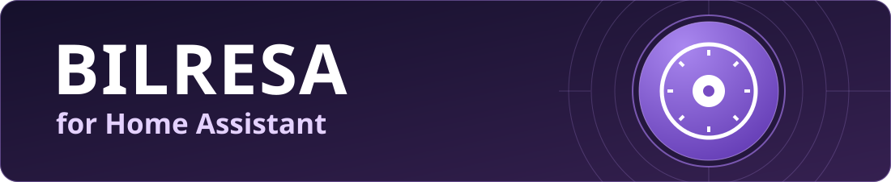

# 

<!-- ha-marketplace:exclude-start -->

<!-- ha-marketplace:exclude-end -->

Control lights, media players and other Home Assistant devices with IKEA BILRESA
Matter remotes. Configure channels and gestures in the Home Assistant interface.

*Dashboard preview with example devices.*

Maintained by **Les.**, based on the work of [Vituhlos and contributors](https://github.com/Vituhlos/ha-ikea-bilresa). This independent community project is not affiliated with or endorsed by IKEA.

See the [changelog](CHANGELOG.md) for changes relative to the upstream release.

**New to BILRESA?** Follow the [illustrated quick start](docs/QUICK-START.md)
to set up your first lamp. The [full user manual](docs/USER-GUIDE.md) covers
volume, colour, follower lights, scenes and troubleshooting.

## Features

- Discover supported BILRESA wheels and buttons through Matter.
- Bind rotation and gestures to Home Assistant entities and actions.
- Configure brightness, colour, media volume and other supported controls.
- Use an optional follower light with a configurable brightness offset. It is
  adjusted only when already on.
- Manage bindings from the integration panel; no household-specific settings
  are included.

## Requirements

- Home Assistant 2026.8 or newer, with Matter integration and Matter Server.
- A supported BILRESA device commissioned over Matter/Thread.

## Installation

1. Add your remote to Home Assistant through Matter.
2. In Home Assistant 2026.11 or newer, install BILRESA from **Settings → Marketplace**.
   If you are on 2026.8–2026.10, use the [HACS steps](docs/INSTALLATION.md#hacs-on-older-home-assistant-versions).
3. Follow the setup prompt or add **IKEA BILRESA** under **Settings → Devices & services**.
   Restart if prompted, then open **IKEA BILRESA** in the sidebar.

See the [quick start](docs/QUICK-START.md) for each step, the
[installation guide](docs/INSTALLATION.md) for manual installation and migration,
and [compatibility](docs/COMPATIBILITY.md) for target requirements.

## Testing and compatibility

See [project status](PROJECT_STATUS.md) and the [hardware validation plan](docs/HARDWARE-VALIDATION.md)
for current coverage and limitations. Automated tests run on the Home Assistant
versions defined in the workflows; hardware, Matter networks and Zigbee2MQTT
groups can behave differently.

Run `node --test tests/panel_frontend.test.mjs tests/iconset_frontend.test.mjs`
for frontend tests. Install `requirements-test.txt` and run `python -m pytest`
for Home Assistant tests. Protocol-only tests can be run with
`python tools/test_pure.py` after installing pytest and pytest-asyncio.

## Credits and license

The upstream MIT license and copyright are retained in [LICENSE](LICENSE).
See [third-party notices](THIRD_PARTY_NOTICES.md) for source attribution.
