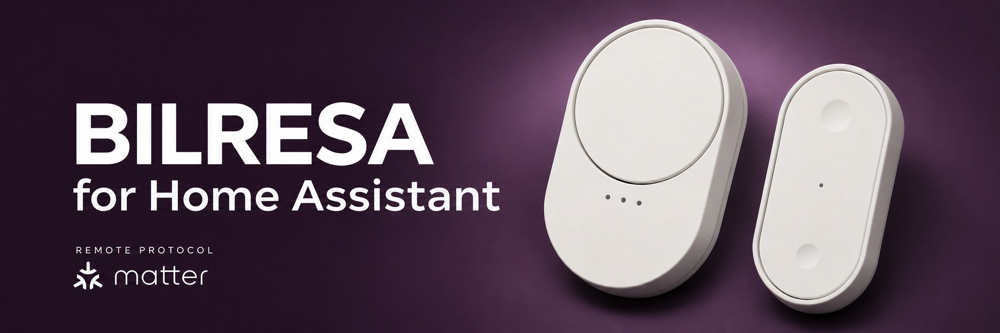
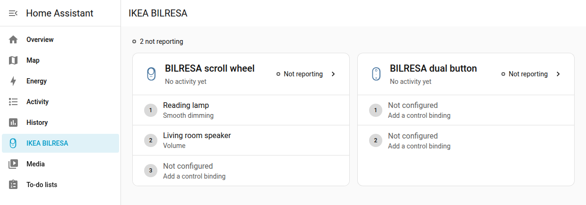
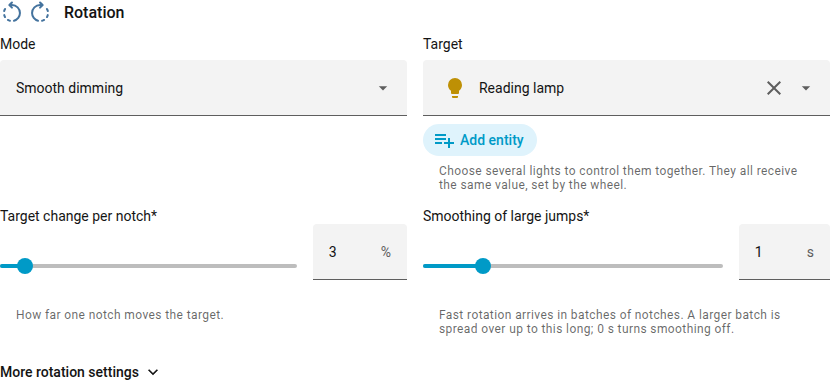
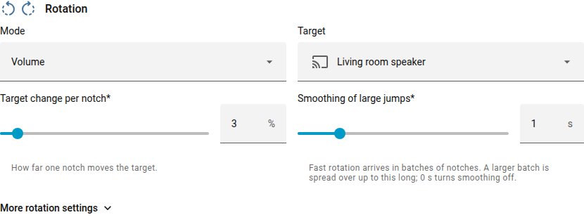
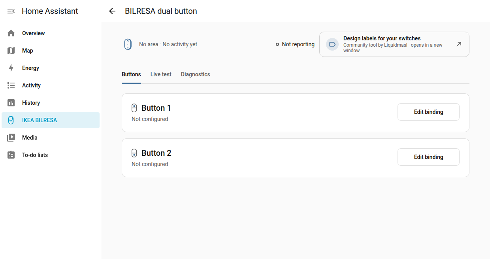
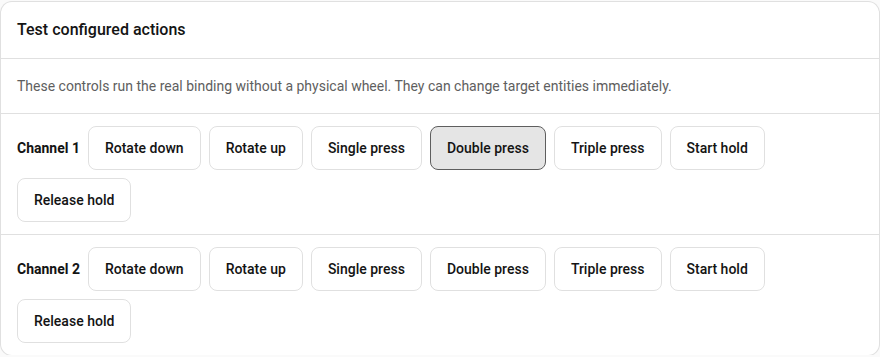

# BILRESA.MasterControl

# 

<!-- ha-marketplace:exclude-start -->

<!-- ha-marketplace:exclude-end -->

Use an IKEA BILRESA remote to dim the lights, adjust a speaker or launch a scene.
Choose what each turn or press does in the Home Assistant panel.

- **[Quick Start](docs/QUICK-START.md)** — Install the integration and set up your first lamp.
- **[Full Manual](docs/USER-GUIDE.md)** — Configure both remotes, explore examples and troubleshoot.

## Central button and scroll control

Version 0.2.0 adds bounded hold actions that stop on release, optional release
sequences, observe-only button actions for migration, and linked profiles for
existing channel bindings. Scroll settings and entity IDs are retained.
See [MasterControl setup and rollback](docs/MASTERCONTROL.md).

## Get started

You need **Home Assistant 2026.8 or newer**, its Matter integration and Matter
Server, and a BILRESA remote paired over Matter. The remote uses Thread, so
you also need a Thread border router.

1. Check that your remote appears under **Settings → Devices & services → Matter**.
2. On Home Assistant 2026.11 or newer, add BILRESA from **Settings → Marketplace**.
   On 2026.8–2026.10, use the [HACS steps](docs/INSTALLATION.md#hacs-on-older-home-assistant-versions).
3. Follow the setup prompt or add **BILRESA.MasterControl** under **Settings → Devices &
   services**. Restart if prompted, then open **BILRESA.MasterControl** in the sidebar.

See the [installation guide](docs/INSTALLATION.md) for pre-releases, manual
installation and migration from an existing setup.

## What you can do

### Manage both remotes in one panel

Select a remote to see its current assignments and edit them. This example
uses the same scroll wheel for the reading lamp on channel 1 and the speaker
on channel 2. The dual button has two controls you can assign independently.

*This demo uses example devices. They show **Not reporting** until the panel receives a gesture.*

### Dim a lamp or a group

Choose **Smooth dimming**, pick a light or group and set how much one notch
changes brightness. In this example, the wheel adjusts the reading lamp by
3% per notch. A separate press action can switch the same lamp on and off.

Use a [follower light](docs/USER-GUIDE.md#example-brightness-and-follower-light)
to keep an accent lamp dimmer than the main lamp while both are on. You can
also [dim a Zigbee2MQTT group](docs/USER-GUIDE.md#dim-a-light-group) that Home
Assistant exposes as a brightness-capable light.

### Adjust volume on another channel

Choose **Volume**, select a compatible media player and start with a small
step. In this example, each notch changes the speaker volume by 3%. You can
assign play/pause to a short press.

Other wheel modes include [colour and colour temperature](docs/USER-GUIDE.md#example-colour),
cover position, fan speed and climate settings. See
[compatibility](docs/COMPATIBILITY.md) for the capabilities each target needs.

### Give each button a job

Open **Buttons** on a dual-button remote and select **Edit binding**. For
example, set one button to switch a lamp and the other to start a scene.
You can also [use gestures in Home Assistant automations](docs/USER-GUIDE.md#use-scenes-and-automations).

### Check a gesture before changing your setup

Open **Live test** and use your remote to see which gesture arrived. Then
expand **Test configured actions** to check the assigned action from the
panel. These controls run the action on the selected target.

The [troubleshooting guide](docs/USER-GUIDE.md#troubleshoot) covers missing
remotes, lights that jump between levels and volume that stays fixed.

## Releases and validation

See the [releases](https://github.com/WI-Les/ha-bilresa/releases) for available
versions and the [changelog](CHANGELOG.md) for changes. The
[project status](PROJECT_STATUS.md) and [hardware validation plan](docs/HARDWARE-VALIDATION.md)
record test coverage and the device combinations still to check.

## Credits and license

Maintained by **Les.**, based on the work of [Vituhlos and contributors](https://github.com/Vituhlos/ha-ikea-bilresa).
This is an independent community project.
The upstream MIT license and copyright are retained in [LICENSE](LICENSE).
See [third-party notices](THIRD_PARTY_NOTICES.md) for source attribution.
