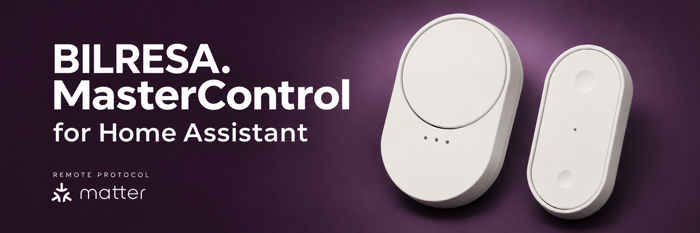

# BILRESA.MasterControl

[English](README.md) · **Nederlands**

<!-- ha-marketplace:exclude-start -->

<!-- ha-marketplace:exclude-end -->

Bedien lampen, luidsprekers en andere apparaten met uw IKEA BILRESA Matter-afstandsbediening. Stel draaien, enkel of dubbel drukken, vasthouden en loslaten in één paneel in. Het draaiwiel ondersteunt ook driemaal drukken.

**Begin hier: [Nederlandse snelstart](docs/nl/QUICK-START.md).** U krijgt eerst één afstandsbediening met één lamp werkend.

De bestaande afbeeldingsknoppen hebben Engelse opschriften. Ze openen hier de Nederlandse uitleg.

## Installeren

De stabiele versie is [**0.2.1**](https://github.com/WI-Les/ha-bilresa/releases/tag/v0.2.1). Voor Nederlands is er geen apart pakket. Engels, Tsjechisch en Nederlands zitten in dezelfde integratie en repository.

- Vereist: **Home Assistant 2026.8 of nieuwer**, een werkende Matter-integratie en Matter Server. Koppel de afstandsbediening eerst aan Matter. Voor deze Thread-apparaten is een werkend Thread-netwerk met borderrouter nodig.
- Vanaf **Home Assistant 2026.11**: gebruik de Marketplace-knop hierboven. Kies stabiele **0.2.1**. Voorafgaande versies (*pre-releases*) hoeven niet aan te staan.
- Op **2026.8–2026.10**: gebruik [HACS](https://my.home-assistant.io/redirect/hacs_repository/?owner=WI-Les&repository=ha-bilresa&category=integration) of de [handmatige installatie](docs/nl/INSTALLATION.md#handmatig-installeren).

**Installeren** plaatst de bestanden. Daarna **voegt u de integratie toe** onder **Instellingen → Apparaten & diensten → Integratie toevoegen** (*Settings → Devices & services → Add integration*). Vervolgens **stelt u de bediening in** via BILRESA.MasterControl in de zijbalk.

Bij bijwerken blijven het domein `ikea_bilresa`, bestaande entiteits-ID’s, bedieningskoppelingen en Matter-koppelingen behouden. Installeer slechts één uitvoering van dit domein. Maak eerst een back-up.

## Wat kunt u doen?

- Draai aan het wiel om helderheid, kleur, kleurtemperatuur, volume of een andere ondersteunde waarde te wijzigen.
- Stel per knopactie een doel in. Een **doel** is bijvoorbeeld de lamp of luidspreker die u wilt bedienen. Een **bedieningskoppeling** verbindt een kanaal of knop met zo’n doel en de gewenste acties.
- Kies voor vasthouden tussen dimmen en een reeks Home Assistant-acties. Stop bij loslaten, stel een tijdslimiet in en voeg eventueel acties na loslaten toe.
- Laat meerdere draaiwielen dezelfde instellingen delen via een gedeeld profiel.
- Laat een tweede lamp meedimmen zolang die al aan is.
- Controleer ontvangen bedieningen en verstuurde acties in **Live testen**. De testknoppen kunnen echte apparaten bedienen.

Het draaiwiel heeft drie kanalen. De tweeknopsafstandsbediening heeft twee knoppen en geen draaibediening. De beschikbare keuzes volgen de hardware.

## Nederlands kiezen

Het huidige paneel volgt uw **profieltaal** in Home Assistant: open uw profiel via uw naam onderaan de zijbalk en kies **Taal → Nederlands** (*Language → Nederlands*). `nl`, `nl-NL` en `nl-BE` kiezen dezelfde Nederlandse teksten. Bij een niet ondersteunde profieltaal gebruikt het paneel de instantietaal; oudere gecachte paneelversies gebruiken ook die terugval.

De door Home Assistant opgebouwde entiteitsnamen volgen de **instantietaal** onder **Instellingen → Systeem → Algemeen** (*Settings → System → General → Language*). Zelf aangepaste namen worden niet overschreven. Herstart na een integratie-update en vernieuw de browser. Zie de [taaluitleg](docs/nl/USER-GUIDE.md#taal).

## Handleidingen

| Uitleg | Wat vindt u er? |
| --- | --- |
| [Snelstart](docs/nl/QUICK-START.md) | Eén lamp instellen en testen |
| [Installeren en bijwerken](docs/nl/INSTALLATION.md) | Marketplace, HACS, handmatig, back-up en terugzetten |
| [Gebruikershandleiding](docs/nl/USER-GUIDE.md) | Alle bedieningen, profielen, migratie en probleemoplossing |
| [Release-informatie 0.2.1](docs/nl/RELEASE-0.2.1.md) | Wat is toegevoegd en wat is gecontroleerd? |
| [Hardwarevalidatie, Engels](docs/HARDWARE-VALIDATION.md) | Grenzen van de fysieke testdekking |

Deze bestaande afbeelding toont het echte paneel met **gesimuleerde apparaten en Engelse labels**. Ze bewijst geen fysieke werking. Alle voorbeelden in de Nederlandse uitleg zijn fictief. Automatische tests vervangen geen test met uw eigen lamp en afstandsbediening.

## Makers en licentie

Onafhankelijk communityproject van **Les.**, gebaseerd op [Vituhlos/ha-ikea-bilresa](https://github.com/Vituhlos/ha-ikea-bilresa). De oorspronkelijke realtime Matter-bediening blijft behouden. Zie [LICENSE](LICENSE) en [THIRD_PARTY_NOTICES.md](THIRD_PARTY_NOTICES.md).
