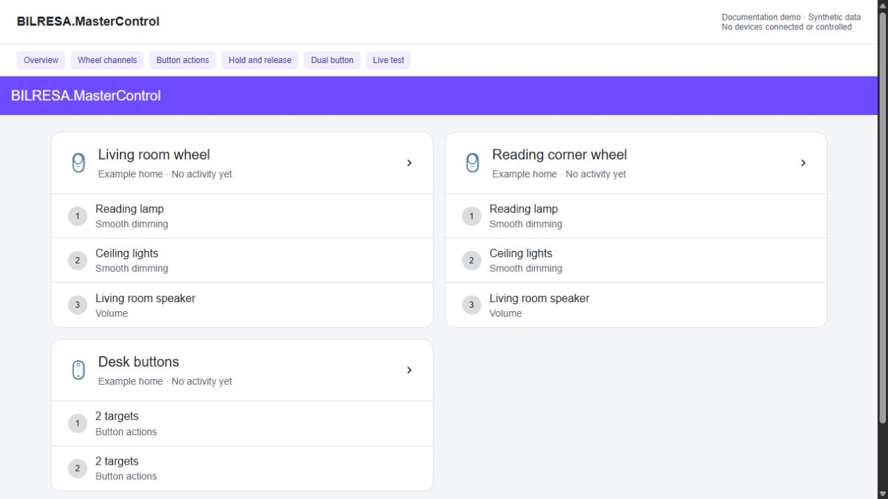
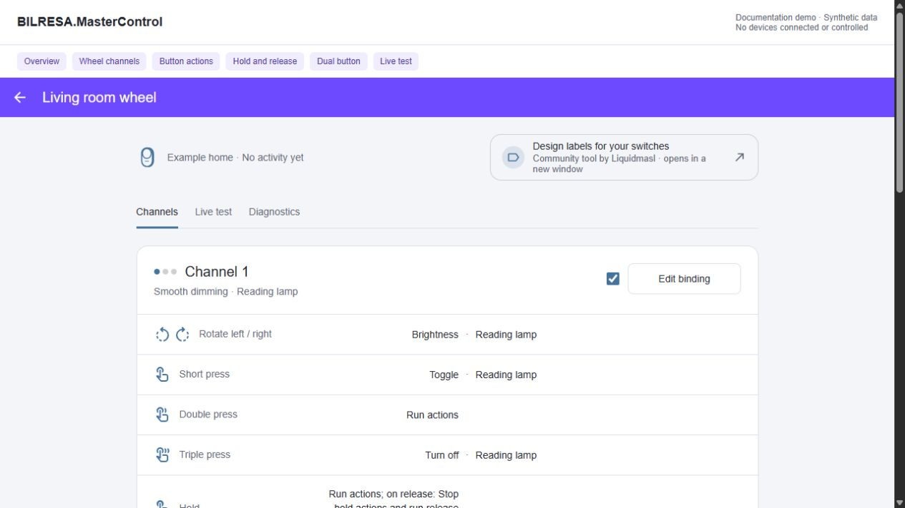
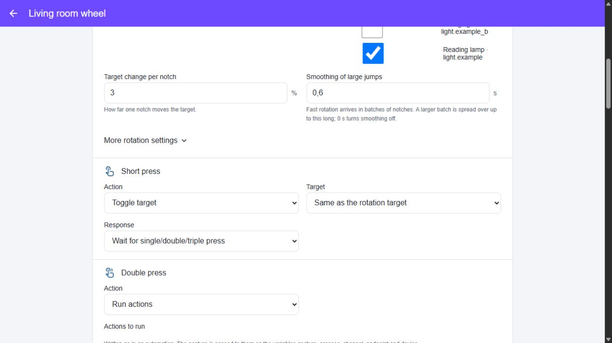
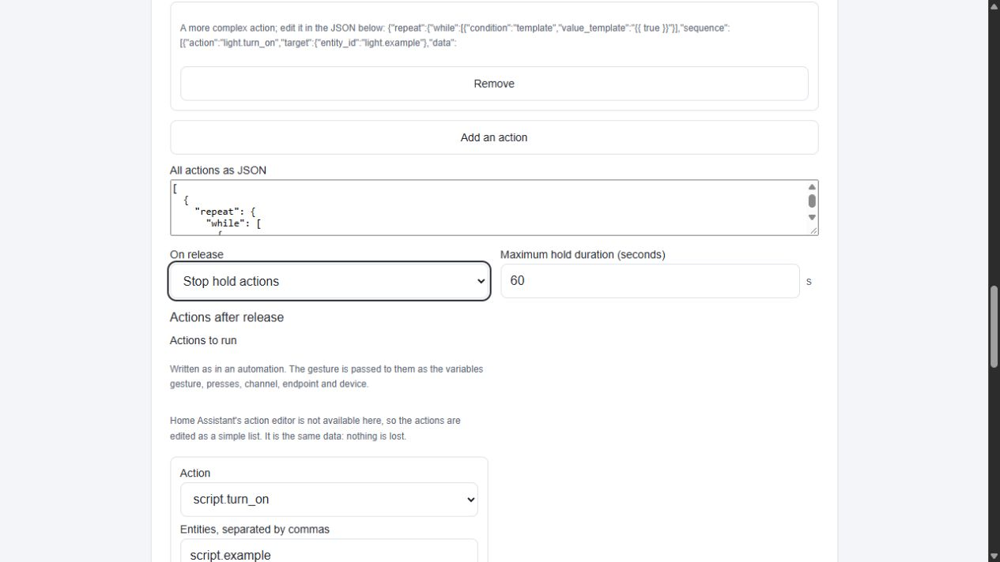
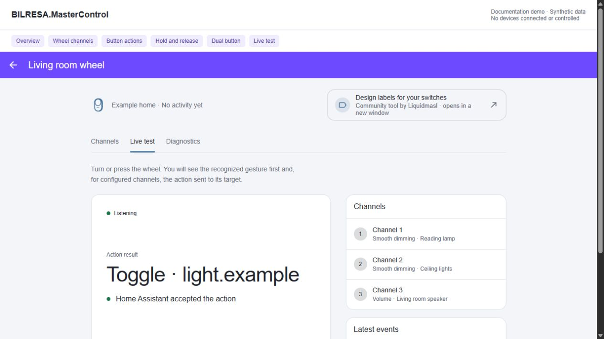

# Quick Start — BILRESA.MasterControl

This guide covers **0.2.0-rc.2**. Start with one remote and one light, then add the other gestures. Screenshots show the shipped panel with synthetic examples; Home Assistant's native selectors and action editor can look different. [About the screenshots](SCREENSHOTS.md).

## 1. Prepare

You need Home Assistant **2026.8+**, a working Matter integration/Matter Server and a BILRESA remote already commissioned into Matter. A Thread remote also needs working Thread infrastructure. Confirm that your first target light responds normally in Home Assistant.

Back up the existing integration and its configuration before upgrading. Keep old button automations and their enabled states so you can restore them.

## 2. Install BILRESA.MasterControl

Use [Marketplace, HACS or manual installation](INSTALLATION.md). Check the version offered: the stable 0.1.0 release has the older interface; the current source candidate has MasterControl features. Downloading `main` and selecting a published release are different installation paths.

Restart Home Assistant. For a new installation, choose **Settings → Devices & services → Add integration → BILRESA.MasterControl** and follow the connection flow. Existing `ikea_bilresa` installations retain their config entry and entities; do not add a second copy or re-pair the remote.

The integration reuses the configured core Matter connection when possible. If setup asks for a connection, use the Matter Server WebSocket address reachable from Home Assistant, not the Home Assistant web address. See [connection troubleshooting](USER-GUIDE.md#troubleshooting).

## 3. Open your remote

Open **BILRESA.MasterControl** in the sidebar. Each discovered wheel remote shows three channels; a dual-button remote shows two buttons. Select your remote.

If no remote appears, confirm its availability in Matter and check the panel diagnostics before changing bindings.

## 4. Bind one light

In **Channels**, choose **Edit binding** for Channel 1:

1. Set **Mode → Smooth dimming**.
2. Choose one light or a Home Assistant light group as **Target**.
3. Start with **Target change per notch → 3%**. Keep **Smoothing of large jumps** at the default unless you have a reason to change it.
4. Set **Short press → Toggle target**. Leave its target at **Same as the rotation target**.
5. Save the binding.

Turn the physical wheel in both directions on that channel. A target that is off may turn on when brightness increases. Check the actual target state as well as the Live test result.

## 5. Add double and triple presses

Edit the same binding and keep **Response → Wait for single/double/triple press**. This allows the integration to distinguish the gestures.

- Assign **Double press → Run actions** to call a scene or script.
- Assign **Triple press → Turn target off**, with the intended target selected.
- Use **No action** for gestures you do not want.

The normal Home Assistant action editor is used when available. A simple list and JSON editor are supplied as a fallback. Use the [manual's examples](USER-GUIDE.md#run-home-assistant-actions) for repeats, delays and templates.

## 6. Configure hold and release

For simple dimming, choose **Hold → Ramp rotation target**. For a custom sequence, choose **Run actions**, enter its actions and select **On release → Stop hold actions** if it should run only while held.

**Maximum hold duration** defaults to **60 seconds**, accepts **1–300 seconds**, and stops a hold sequence even if the release is lost. **Actions after release** is optional and runs after a recognized hold is released. A timeout does not run release actions.

Use a delay inside continuous repeats. A light transition already accepted by a lamp can finish after the integration has stopped sending commands. See [hold behaviour](USER-GUIDE.md#hold-and-release) before using a continuous colour cycle.

## 7. Test and expand

Open **Live test** and use the physical remote. Check:

- Both rotation directions and the active channel.
- Single, double and triple presses that have assignments.
- Hold start, release stop and any release action.
- The actual light, speaker or other target response.

The panel's action test controls send real commands on a real installation. “Home Assistant accepted the action” confirms dispatch; it does not prove that a lamp physically responded.

Then configure the other channels, [dual-button remotes](USER-GUIDE.md#dual-button-remotes) or [shared profiles](USER-GUIDE.md#shared-profiles).

## Moving existing automations

Start with **Button actions → Observe only (scrolling stays active)** while copying your actions. This suppresses the binding's button actions, but event entities, triggers and virtual switches can still drive existing automations. Disable the old automation for a gesture before activating its replacement binding.

Keep the old automations disabled as a fallback. Do not delete colour-memory helpers or unrelated support automations simply because button actions moved into MasterControl. Follow [migration and recovery](MASTERCONTROL.md) for the full procedure.
