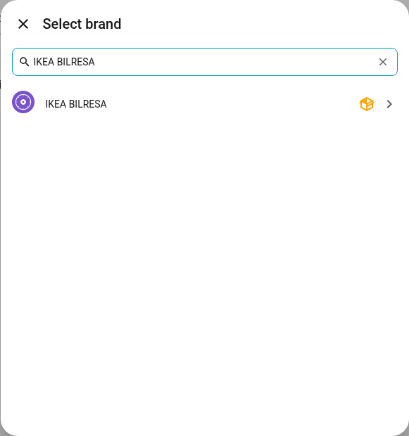

# BILRESA quick start

Set up one lamp first. A scroll wheel can switch it with a press and dim it
as you turn. A dual button can switch it with a press. Once that works, you
can add more lights, use another wheel channel for volume or assign a press
to a scene.

## 1. Check your remote and lamp

- Use Home Assistant **2026.8 or newer** with its **Matter** integration and
  Matter Server. Under **Settings → Devices & services → Matter**, check that
  your BILRESA remote is listed. For a new remote, use the Home Assistant
  Companion app and follow the [Matter setup guide](https://www.home-assistant.io/integrations/matter/#adding-a-matter-device-to-home-assistant).
  A Matter-over-Thread remote needs a Thread border router.
- Pick a lamp you can already switch from Home Assistant. To try dimming,
  choose one that also has a brightness slider.
- Keep a Home Assistant backup before installing. If another automation
  already handles the same press or turn, see the
  [migration steps](INSTALLATION.md#configure-and-migrate).

## 2. Install IKEA BILRESA

On Home Assistant **2026.8–2026.10**, use the
[HACS steps](INSTALLATION.md#hacs-on-older-home-assistant-versions) and
continue at step 3. To install from files, see
[manual installation](INSTALLATION.md#manual-installation).

1. On Home Assistant **2026.11 or newer**, select [**Open in Marketplace**](https://my.home-assistant.io/redirect/marketplace_repository/?owner=WI-Les&repository=ha-bilresa&category=integration).
   You can also go to **Settings → Marketplace → Add from link** and enter
   `https://github.com/WI-Les/ha-bilresa`. If Marketplace asks you to connect
   GitHub, follow the sign-in prompt.
2. On the BILRESA page, select **Install**. To install
   [**0.1.0-rc.2**](https://github.com/WI-Les/ha-bilresa/releases/tag/v0.1.0-rc.2),
   follow the [Marketplace pre-release steps](INSTALLATION.md#install-a-release-candidate)
   before selecting **Install**.
3. Restart if prompted. If the setup form did not open after installation,
   go to **Settings → Devices & services → Add integration** as an
   administrator. Search for **IKEA BILRESA** in the **Select brand** dialog
   and choose the result.

   

4. Check the pre-filled **Matter Server WebSocket URL** and select **Submit**.
   For a separate Matter Server, use the address already configured for the
   Home Assistant Matter integration. The
   [setup screen](USER-GUIDE.md#install-and-connect) shows where to enter it.
5. Open **IKEA BILRESA** in the sidebar and select your remote.

## 3. Set up your first lamp

### Scroll wheel

1. Open **Channels** and select **Edit binding** for **Channel 1**.
2. In **Rotation**, choose **Smooth dimming** for **Mode**. Under **Target**,
   select your lamp. Use **3%** for **Target change per notch** as a starting
   point.

   

3. In **Short press**, choose **Toggle target** as the action. Leave
   **Target** empty to use the lamp selected under **Rotation**. Leave double
   press, triple press and hold at **No action** for this example.

   

4. Select **Save** at the bottom of the form. Check that **Channel 1** is
   enabled. Use the button below the LEDs on the remote to select the first
   channel.

### Dual button

1. Open **Buttons** and select **Edit binding** for **Button 1**.
2. In **Short press**, choose **Toggle target** and select your lamp under
   **Target**.
3. Select **Save**. The
   [Buttons tab screenshot](USER-GUIDE.md#configure-a-dual-button) shows
   where each button is configured.

## 4. Try it and check what happened

Press the wheel or button once. The lamp should switch on or off. With
the lamp on, turn the wheel a few notches each way to test dimming.

If the lamp stays unchanged, open **Live test** in the BILRESA panel and
try the same gesture.

- **The gesture appears.** Expand **Test configured actions** and select
  **Single press** on the same channel or button. This runs the action on
  the actual lamp. If the lamp still stays unchanged, check the target and
  verify that the binding is enabled.
- **The gesture is missing.** Check that the remote is available in Matter
  and that you are viewing the correct remote. On a wheel, also check
  which channel you selected.

See the [Live test screenshot](USER-GUIDE.md#test-your-controls) and
[troubleshooting table](USER-GUIDE.md#troubleshoot) for more help.

## What to try next

| I want to… | Start here |
| --- | --- |
| Dim several lamps together | [Dim a light group](USER-GUIDE.md#dim-a-light-group) |
| Keep an accent lamp dimmer than the main light | [Set a follower light](USER-GUIDE.md#example-brightness-and-follower-light) |
| Use another channel for the speaker | [Set up volume](USER-GUIDE.md#example-volume) |
| Change a lamp's colour | [Set up colour control](USER-GUIDE.md#example-colour) |
| Use a press to start a scene or automation | [Use scenes and automations](USER-GUIDE.md#use-scenes-and-automations) |
