# BILRESA quick start

Set up one lamp first. A scroll wheel can switch it with a press and dim it
as you turn. A dual button can switch it with a press. Once that works, you
can add more lights, use another wheel channel for volume or assign a press
to a scene.

## 1. Check your remote and lamp

- Use Home Assistant **2026.8 or newer** with its **Matter** integration and
  Matter Server. Under **Settings → Devices & services → Matter**, check that
  your BILRESA remote is listed. For a new remote, use the Home Assistant
  Companion app and follow the [Matter setup guide](https://www.home-assistant.io/integrations/matter/#adding-a-matter-device-to-home-assistant).
  A Matter-over-Thread remote needs a Thread border router.
- Pick a lamp you can already switch from Home Assistant. To try dimming,
  choose one that also has a brightness slider.
- Keep a Home Assistant backup before installing. If another automation
  already handles the same press or turn, see the
  [migration steps](INSTALLATION.md#configure-and-migrate).

## 2. Install IKEA BILRESA

The screenshots show a fresh installation on Home Assistant **2026.11.1**.
On **2026.8–2026.10**, use [HACS](INSTALLATION.md#hacs-on-older-home-assistant-versions).
For a local copy of the release, use the
[manual installation steps](INSTALLATION.md#manual-installation).

### Open Marketplace

1. Sign in to Home Assistant as an administrator. Open **Settings** in the
   sidebar and choose **Marketplace**. You can also use the
   [Open in Marketplace button](https://my.home-assistant.io/redirect/marketplace_repository/?owner=WI-Les&repository=ha-bilresa&category=integration)
   to go directly to BILRESA.

   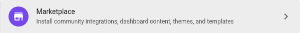

2. On your first visit, review the Marketplace notice. If you agree, tick
   **I understand the risks and agree** and select **Continue**.

   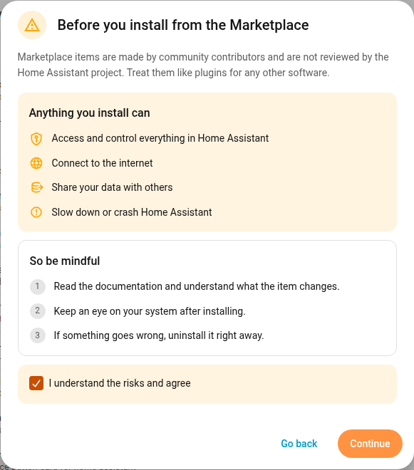

### Add BILRESA and connect GitHub

1. In Marketplace, select **Add from link** in the top right.

   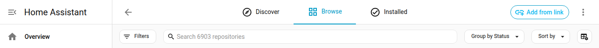

2. Paste `https://github.com/WI-Les/ha-bilresa` into **GitHub link** and
   select **Add**. If asked to pick a type, choose **Integration**.

   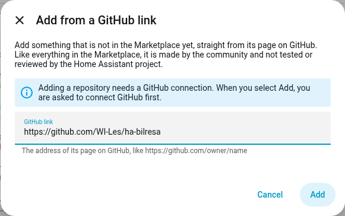

3. If **Connect GitHub** opens, select **Continue**.

   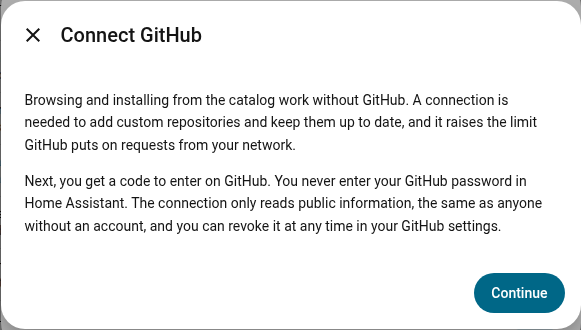

4. Open the GitHub link in the dialog, sign in on GitHub and enter the code
   shown in your own Home Assistant. Approve the connection on GitHub and
   return to Home Assistant. The code in the screenshot is an example.

   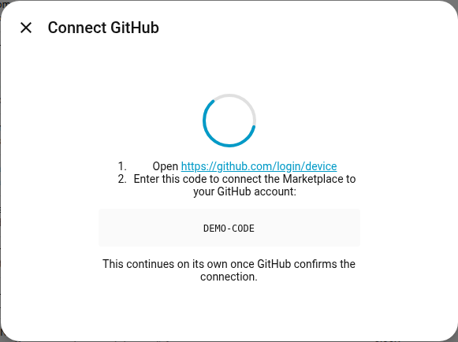

5. In Home Assistant, select **Close** when Marketplace confirms the
   connection. It then finishes adding the repository.

   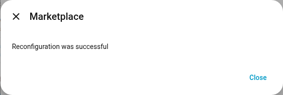

### Install the stable release

1. In the **Browse** tab, search for **IKEA BILRESA** and select the
   **IKEA BILRESA** result.

   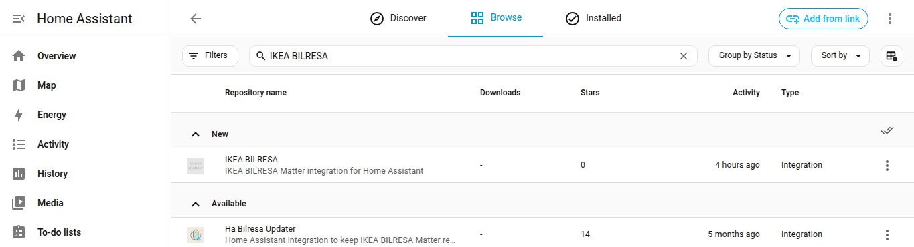

2. Select **Install** on the repository page. Marketplace offers the stable
   release with its default settings.

   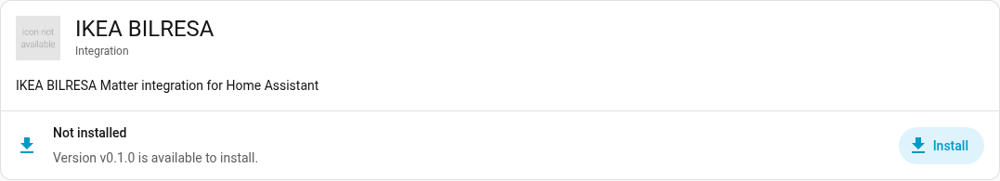

3. Check that the confirmation dialog shows **v0.1.0** or a newer stable
   version, then select **Install** again.

   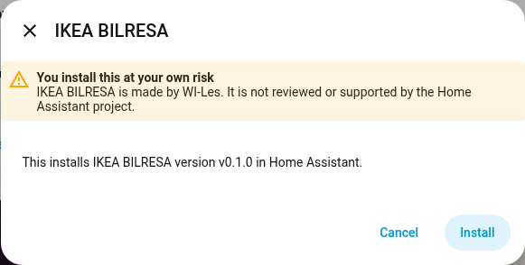

### Connect to Matter and open the panel

1. Open the setup form when prompted. If a restart is required, restart Home
   Assistant first. To open the form later, go to **Settings → Devices &
   services → Add integration**, then search for
   [**IKEA BILRESA**](images/user-guide/07-add-integration.png).
2. Check the pre-filled **Matter Server WebSocket URL** and select
   **Submit**. If you use a separate Matter Server, enter the address
   configured for your Home Assistant Matter integration.

   

3. Open **IKEA BILRESA** in the sidebar. Select your remote in the panel.

   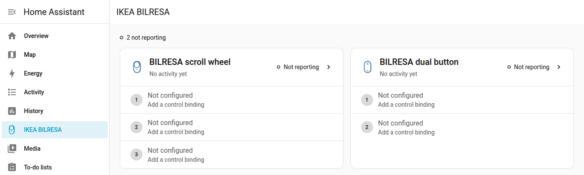

## 3. Set up your first lamp

### Scroll wheel

1. Open **Channels** and select **Edit binding** for **Channel 1**.
2. In **Rotation**, choose **Smooth dimming** for **Mode**. Under **Target**,
   select your lamp. Use **3%** for **Target change per notch** as a starting
   point.

   

3. In **Short press**, choose **Toggle target** as the action. Leave
   **Target** empty to use the lamp selected under **Rotation**. Leave double
   press, triple press and hold at **No action** for this example.

   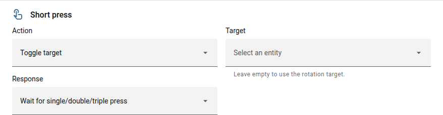

4. Select **Save** at the bottom of the form. Check that **Channel 1** is
   enabled. Use the button below the LEDs on the remote to select the first
   channel.

### Dual button

1. Open **Buttons** and select **Edit binding** for **Button 1**.
2. In **Short press**, choose **Toggle target** and select your lamp under
   **Target**.
3. Select **Save**. The
   [Buttons tab screenshot](USER-GUIDE.md#configure-a-dual-button) shows
   where each button is configured.

## 4. Try it and check what happened

Press the wheel or button once. The lamp should switch on or off. With
the lamp on, turn the wheel a few notches each way to test dimming.

If the lamp stays unchanged, open **Live test** in the BILRESA panel and
try the same gesture.

- **The gesture appears.** Expand **Test configured actions** and select
  **Single press** on the same channel or button. This runs the action on
  the actual lamp. If the lamp still stays unchanged, check the target and
  verify that the binding is enabled.
- **The gesture is missing.** Check that the remote is available in Matter
  and that you are viewing the correct remote. On a wheel, also check
  which channel you selected.

See the [Live test screenshot](USER-GUIDE.md#test-your-controls) and
[troubleshooting table](USER-GUIDE.md#troubleshoot) for more help.

## What to try next

| I want to… | Start here |
| --- | --- |
| Dim several lamps together | [Dim a light group](USER-GUIDE.md#dim-a-light-group) |
| Keep an accent lamp dimmer than the main light | [Set a follower light](USER-GUIDE.md#example-brightness-and-follower-light) |
| Use another channel for the speaker | [Set up volume](USER-GUIDE.md#example-volume) |
| Change a lamp's colour | [Set up colour control](USER-GUIDE.md#example-colour) |
| Use a press to start a scene or automation | [Use scenes and automations](USER-GUIDE.md#use-scenes-and-automations) |
