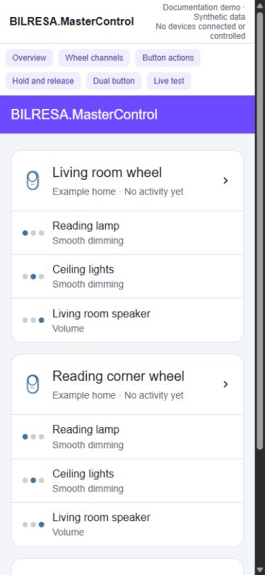

# Documentation screenshots

Captured on **22 November 2026** from the **0.2.0-rc.3** frontend in this repository.

These are browser screenshots of the shipped panel, using synthetic devices and bindings. They are not screenshots of a household installation and do not prove physical operation. The preview banner identifies the demo. Views scrolled into an editor section may not include that banner.

## Reproduce

Install the project's test dependencies in a supported Python environment, then run:

```shell
python tools/docs_preview.py
```

Open `http://localhost:8768` in a browser. The preview serves only its fixture and the two shipped frontend modules on loopback. It has no Home Assistant credentials or device connection. Its named view links open the overview, wheel channels, press editor, hold editor, dual-button device and Live test.

The fixture uses the production binding normalizer, panel snapshot builder, schema and translations. The frontend is the actual `ikea_bilresa_panel.js`. Home Assistant's outer shell is replaced by a clearly labelled demo frame. Native Home Assistant selectors and its action editor are unavailable here, so the panel's built-in fallback controls are shown.

## Gallery

| File | View |
| --- | --- |
| [Overview](images/mastercontrol/01-overview.jpg) | Two wheels with channel dots and a dual-button remote with upper/lower symbols |
| [Channels](images/mastercontrol/02-channels.jpg) | Rotation and press/hold action ledger |
| [Press editor](images/mastercontrol/03-button-actions.jpg) | Short press response and double press actions |
| [Hold and release](images/mastercontrol/04-hold-release.jpg) | Stop-on-release, 60-second bound and release actions |
| [Dual button](images/mastercontrol/05-dual-buttons.jpg) | Independent press targets and fixed hold directions |
| [Live test](images/mastercontrol/06-live-test.jpg) | Channel dots and a synthetic accepted action, not a real dispatch |
| [Phone width](images/mastercontrol/07-mobile.jpg) | Overview checked at a 390-pixel viewport |



Desktop captures use the browser's default viewport. The phone capture checks the responsive layout; it is not a claim of physical phone testing. Older images elsewhere in this repository describe earlier releases and are not used by the current Quick Start or manual.

