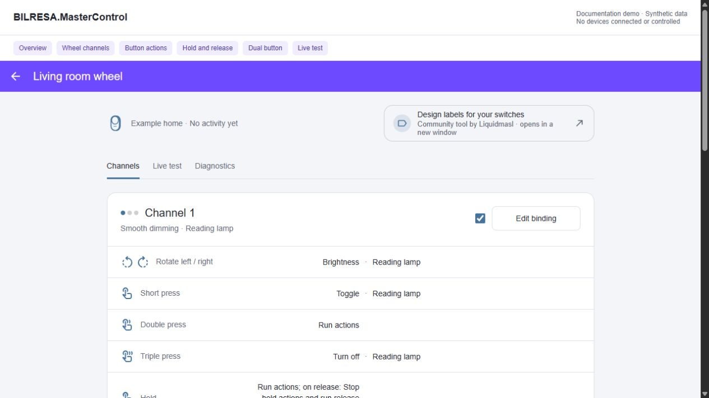
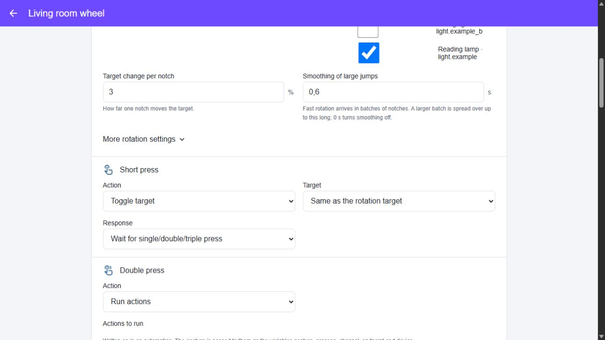
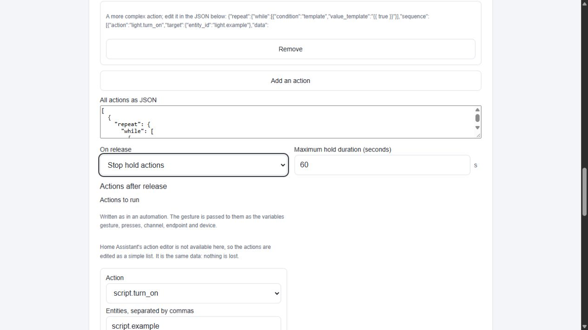
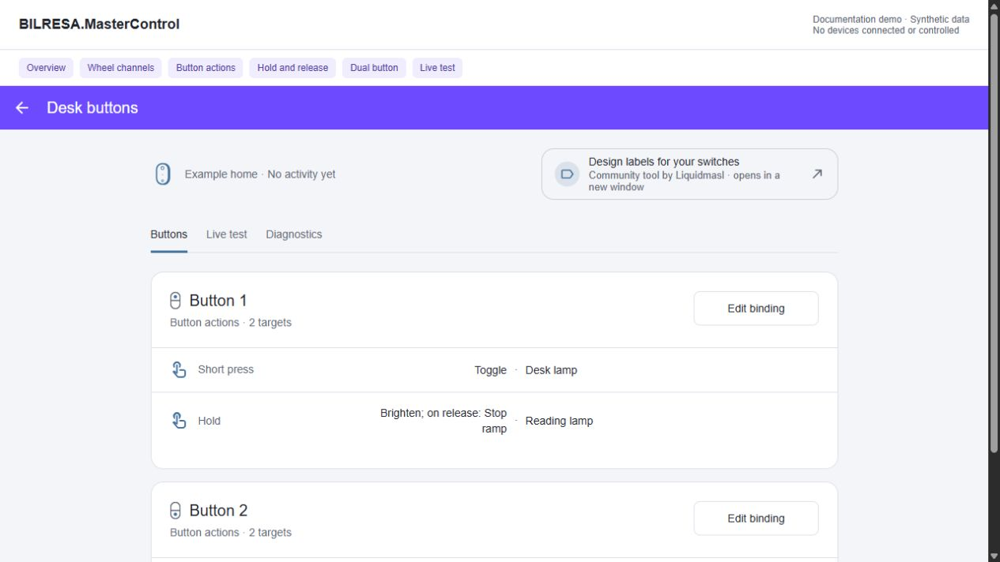
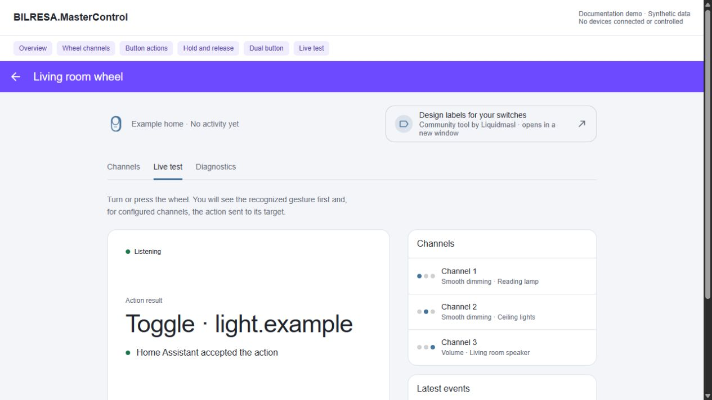

# BILRESA.MasterControl manual

For **0.2.0-rc.3**. The integration's display name is BILRESA.MasterControl; its technical domain and component folder remain `ikea_bilresa`.

[Quick Start](QUICK-START.md) · [Installation](INSTALLATION.md) · [Migration and recovery](MASTERCONTROL.md)

## Contents

- [Connection and discovery](#connection-and-discovery)
- [The panel](#the-panel)
- [Rotation modes](#rotation-modes)
- [Multiple lights and followers](#multiple-lights-and-followers)
- [Press actions and response](#press-actions-and-response)
- [Run Home Assistant actions](#run-home-assistant-actions)
- [Hold and release](#hold-and-release)
- [Dual-button remotes](#dual-button-remotes)
- [Shared profiles](#shared-profiles)
- [Entities and automation triggers](#entities-and-automation-triggers)
- [Live test and diagnostics](#live-test-and-diagnostics)
- [Migrate existing button automations](#migrate-existing-button-automations)
- [Troubleshooting](#troubleshooting)

## Connection and discovery

Commission the BILRESA remote into Home Assistant's **Matter** integration first. MasterControl listens to Matter events; it does not commission remotes or replace a Thread border router. Targets can be Zigbee, Wi-Fi, Matter or any other supported Home Assistant entity.

On setup, MasterControl reuses Home Assistant's configured Matter client when possible. A separate Matter Server WebSocket connection is available when needed. New supported remotes are discovered without creating a separate integration instance for each remote.

Home Assistant **2026.8 or newer** is required. For package selection, restart requirements and upgrading from the original integration, follow [Installation](INSTALLATION.md). Only one component may own the `ikea_bilresa` domain at a time.

## The panel

Open **BILRESA.MasterControl** from the sidebar. Device names and areas come from Home Assistant. A scroll wheel provides three independent channels; the dual-button model provides two buttons.


Select a device for **Channels** or **Buttons**, **Live test**, and **Diagnostics**. The channel ledger lists rotation, short press, double press, triple press and hold/release together. Only relevant assigned gestures appear. Choose **Edit binding** to configure them in the same order.

The overview and Live test use the same three-dot channel symbols as the detail pages. The first, second or third highlighted dot means Channel 1, 2 or 3; it is a channel identifier, not a connection indicator. Dual-button remotes use the upper/lower physical button symbol. Markers retain localized tooltips and accessible channel/button names.



The **active** checkbox enables or disables the whole channel in this integration. A disabled channel keeps its configuration but suppresses dispatch: no integration bus events, entity/dial/switch updates or direct binding actions. This differs from observe-only button actions, which retain events and scrolling. Save/Discard apply to the open editor. Concurrent edits are checked through binding revisions; review a conflict before saving again.

The panel adapts to narrower screens. Documentation screenshots render the actual frontend with synthetic data outside a full Home Assistant frontend. The native Home Assistant selectors and action editor may differ. [Provenance and reproduction](SCREENSHOTS.md).

## Rotation modes

| Mode in the panel | Target | Wheel effect |
| --- | --- | --- |
| Buttons only | Optional default press target | No rotation command; presses and hold remain configurable |
| Smooth dimming | Light, light group or several lights | Adjust brightness within the configured limits |
| Colour temperature | Supported light(s) | Adjust within the target's reported colour-temperature range |
| Colour | Supported light(s) | Move around the colour hue range |
| Volume | Media player | Adjust the reported volume level |
| Cover position | Cover supporting position | Adjust position |
| Temperature | Climate entity | Adjust target temperature within its range |
| Fan speed | Fan supporting percentage | Adjust speed percentage |
| Value | Number or input number | Adjust the value within the entity's range |

Use a target that supports the selected quantity. A volume target without a valid reported volume is skipped until it reports a usable level; the integration does not guess a starting volume. Unavailable targets are not proof of a broken remote.

### Step, smoothing and limits

**Target change per notch** accepts **1–25**. Most modes map this percentage over a target range. For climate and number targets, inspect the resulting values and their reported minimum, maximum and step.

**Smoothing of large jumps** accepts **0–5 seconds**. Matter can deliver rapid rotation in batches of notches. MasterControl decodes the batch, then spreads larger changes over up to the configured duration. Set **0** to turn smoothing off. This does not make the remote transmit an event for every notch sooner.

Under **More rotation settings**, adjust brightness minimum/maximum, optional acceleration and brightness response curve. Acceleration is **0–100%**, with **0%** disabling it. The perceptual curve is optional; retain linear behaviour when preserving an existing setup. Test the lamp's low end physically.

These settings affect the binding target. They do not configure the separate channel dial described below.

## Multiple lights and followers

In light modes you can select several lights. They receive the same commanded value, based on the binding's tracked position. Selecting a Home Assistant light group is another way to address a group. Individual lamp capabilities and group reporting affect the physical result.

A brightness binding may also have an optional **follower light**, **offset** and **minimum**. For example, **−10%** makes an already-on accent lamp follow below the primary brightness; a minimum prevents it dropping below a chosen usable level.

The follower is adjusted only while already on. It does not turn an off follower on. Primary and follower targets must not overlap, including light-group members. Overlap is checked during configuration and before dispatch. If the primary service call fails, the follower command is skipped. Superseded pending follower updates are discarded.

## Press actions and response

Short, double and triple presses are independent assignments on wheel remotes. Depending on the target, choices include on/off/toggle, scene activation, script execution, media actions and other supported verbs. **No action** leaves that binding gesture unassigned. **Run actions** executes a full Home Assistant sequence. Short press can also **Cycle scenes** in the configured order.

Short press can inherit **Same as the rotation target**. Double/triple presses and hold targets have their own targets. In **Buttons only**, the main target is a default press target; rotating the wheel sends no target command.



Choose **Response** deliberately:

| Response | Behaviour and tradeoff |
| --- | --- |
| Wait for single/double/triple press | Distinguishes completed press counts; use when combining gestures |
| Run after the first short release | Faster single press after release; double/triple assignments are unavailable |
| Run on initial press | Earliest single press; double/triple and hold assignments are unavailable |

The editor marks incompatible gestures unavailable. Faster response cannot also wait to discover whether an initial press becomes a double press or hold. Retain the waiting response for a full gesture setup.

## Run Home Assistant actions

Set a gesture to **Run actions**. The native Home Assistant action editor loads when available. Otherwise the panel supplies a simple action list and **All actions as JSON**. Both edit the same saved data; complex conditions, templates, delays, choices and repeats are preserved.

A minimal sequence in YAML, for Home Assistant's YAML action editor:

```yaml
- action: scene.turn_on
  target:
    entity_id: scene.example
```

The same sequence in **All actions as JSON**:

```json
[
  {
    "action": "scene.turn_on",
    "target": {"entity_id": "scene.example"}
  }
]
```

Replace example entities with your own. Use YAML only in a YAML-capable editor; the fallback JSON box requires valid JSON. Blank action rows and invalid JSON cannot be saved. Edit complex actions through the full editor or JSON.

Sequences receive `gesture`, `presses`, `channel`, `endpoint` and `device` variables. Do not assume an example node identifier is stable in your installation. Validation checks action syntax; it cannot guarantee a service's physical result.

Administrators can call the WebSocket command `ikea_bilresa/binding/validate`, with `node_id`, `channel` and binding `data`, to validate without saving or executing. This developer interface does not replace a physical target test.

## Hold and release

**Hold** offers:

- **Act on the hold target**: perform a supported action on a separately selected target.
- **Ramp rotation target**: continuously change a wheel's light brightness. Direction alternates between holds; release stops the ramp.
- **Run actions**: execute a custom sequence, once per recognized hold session.
- **No action**: no primary hold action; optional release actions can still be assigned.

For **Run actions**, choose **On release**:

- **Stop hold actions** cancels that binding's active or not-yet-started hold sequence.
- **Let hold actions finish** allows it to continue after release, until finished or its maximum duration. Existing bindings retain this behaviour unless stop-on-release is enabled.

**Maximum hold duration** applies to hold action sequences, defaults to **60 seconds** and accepts **1–300 seconds**. It prevents an infinite loop if release is lost. Repeated hold reports do not launch duplicate sequences. Disconnect, removal and unload also stop owned hold work.

**Actions after release** is an optional independent sequence, available for all hold choices. It runs only after a hold has been observed and then released. An orphan release or maximum-duration timeout does not trigger it. With stop-on-release selected, the owned hold sequence stops before release actions run.



### Colour cycle while held

Choose **Run actions**, enable **Stop hold actions**, keep a finite maximum duration and include a delay in the loop. This example alternates two colours:

```yaml
- repeat:
    while:
      - condition: template
        value_template: "{{ true }}"
    sequence:
      - action: light.turn_on
        target:
          entity_id: light.example
        data:
          rgb_color: [255, 70, 20]
          transition: 0.9
      - delay:
          seconds: 1
      - action: light.turn_on
        target:
          entity_id: light.example
        data:
          rgb_color: [20, 80, 255]
          transition: 0.9
      - delay:
          seconds: 1
```

Stopping prevents subsequent steps from being sent. A transition already accepted by a lamp can finish. A separately launched script or external job can have its own lifetime: cancelling the binding does not automatically cancel every job it started. Put repeating work inside the owned sequence when release must stop it, or explicitly manage external script cancellation.

A release sequence can call a script that remembers the selected colour. Keep any colour-memory helpers that script depends on.

## Dual-button remotes

The dual-button BILRESA has **Button 1** and **Button 2**, each with a press/hold binding. It has no wheel rotation or channel dial. Double press is supported; do not assume the wheel's triple press is available on this model.



For dimming, assign a light hold target and choose fixed **Brighten** for one button and **Dim** for the other. Release stops that button's ramp. Press actions can control a different target. Use the waiting response when combining short press, double press and hold.

## Shared profiles

Open **Settings → Devices & services → BILRESA.MasterControl → Configure**. Name the profile and select wheel remotes to link. This dialog supports one linked group.

The first selected remote supplies initial settings for matching channel bindings already present on peers. Subsequently, saving a linked channel on either remote updates the same existing channel bindings on the other members. The editor displays the profile name before the fields.

- Add a binding for an unconfigured peer channel before expecting it to participate. Linking does not create missing channel bindings.
- Settings are shared; device/entity IDs, binding IDs and gesture sessions remain individual.
- A release on one remote never stops another remote's hold.
- Deleting a binding removes that binding only; it does not delete the peer's binding.
- Clear the linked selection to unlink remotes; current settings remain.

Link only remotes that should control the same targets with the same channel settings. Linking intentionally copies settings; back up peers that currently differ.

## Entities and automation triggers

Direct bindings are optional. The integration retains entities for automation-based control:

- **Event entities** report recognized gestures and attributes such as `presses` and `notches`.
- **Channel dial number entities** carry a separate value from **1 to 100**. **Dial change per notch** and **Dial acceleration** configure that value independently of the target binding.
- **Virtual switches** expose channel press state for automations. They are not the physical light's authoritative state.

The seven named triggers are `rotated_up`, `rotated_down`, `pressed`, `double_pressed`, `triple_pressed`, `held` and `released`. Select the applicable BILRESA event entity in Home Assistant's trigger editor. A typed example:

```yaml
triggers:
  - trigger: ikea_bilresa.double_pressed
    target:
      entity_id: event.bilresa_scroll_wheel_channel_1
actions:
  - action: scene.turn_on
    target:
      entity_id: scene.example
```

Use the event entity ID actually present in your installation. Trigger state attributes include `notches` for rotation and `presses` for presses. Named triggers filter this integration's event entities even when core Matter also provides entities on the same device.

The `ikea_bilresa_event` event bus remains available for existing consumers. Avoid configuring both a direct binding and an automation to perform the same response unless you intend both to run.

## Live test and diagnostics

**Live test** shows recognized gestures, channels and configured dispatch results. It distinguishes reception from accepted actions, skipped work and errors.



On a real installation, panel test controls execute configured actions and can move a cover, change a climate setpoint or switch a light. Use a suitable target. Panel-generated activity is identified as such; it is not evidence that a physical remote delivered a gesture.

“Home Assistant accepted the action” confirms dispatch. Check actual target state and physical response separately. Use **Diagnostics** for connection/event details and review exports before sharing. Household screenshots can contain names, entity IDs and network details; these public examples contain no real household identifiers.

## Migrate existing button automations

1. Back up the component folder, integration configuration/subentries and old automations including enabled states.
2. Copy actions into the correct bindings with **Button actions → Observe only (scrolling stays active)**.
3. Observe recognized gestures and validate action syntax.
4. Disable the old automation for one gesture/channel, then set its replacement binding's button actions to **Active**.
5. Test physical presses and hold/release before moving the next channel.
6. Keep old automations disabled as a recovery path and retain helpers still used by the new sequences.

Observe-only suppresses **the binding's direct button actions**. Scrolling remains active. Event entities, named triggers and virtual switches still operate, so external automations can act. It is not a system-wide dry run. **No action** leaves one binding gesture unassigned. In contrast, switching off the channel's **active** checkbox suppresses this integration's dispatch for the whole channel. None of these settings disables core Matter or unrelated controllers.

Retain the config entry, Matter pairing and entity IDs when upgrading the same domain. See [MasterControl migration](MASTERCONTROL.md) and [rollback](INSTALLATION.md#rollback).

## Troubleshooting

| Symptom | Check |
| --- | --- |
| Integration absent after copying files | Complete component folder, restart, startup logs and supported HA version |
| Setup asks for a server | Reachable Matter Server WebSocket endpoint; HA's web URL is not that server |
| No remote or physical events | Core Matter availability, Thread infrastructure, battery and Diagnostics; avoid re-pairing as a first step |
| Scroll works but presses do nothing | Active channel, **Button actions → Active**, assignments, response mode and errors |
| Double/triple or hold unavailable | Waiting response; faster choices intentionally exclude incompatible gestures |
| Action runs twice | Old automations or event/switch consumers alongside direct bindings |
| Colour loop continues after release | Stop-on-release, external script lifetime and device transition time |
| Release action does not run | Requires an observed hold; orphan releases and timeouts do not run it |
| Follower stays off | Intentional while off; also check overlap and primary errors |
| Volume skips | Target must report a valid current volume |
| Linked remote does not update | Matching existing channel binding, selected profile members and successful save |
| Panel looks old | Installed manifest version, restart and frontend reload; check the candidate actually installed |
| Action editor unavailable | Built-in list/JSON fallback retains the same sequence |

Keep diagnosis scoped to the affected remote and target. [Hardware validation](HARDWARE-VALIDATION.md) lists the physical checks automated tests cannot replace.
