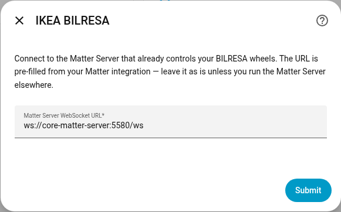
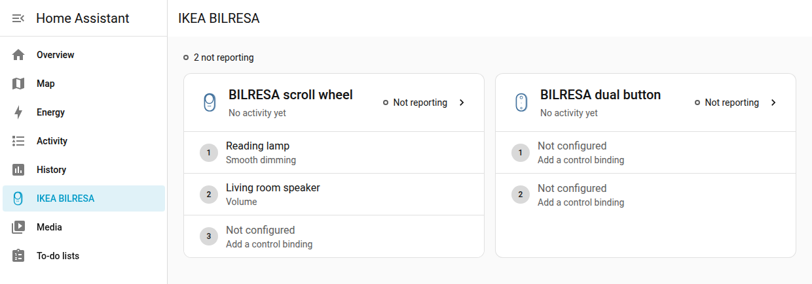
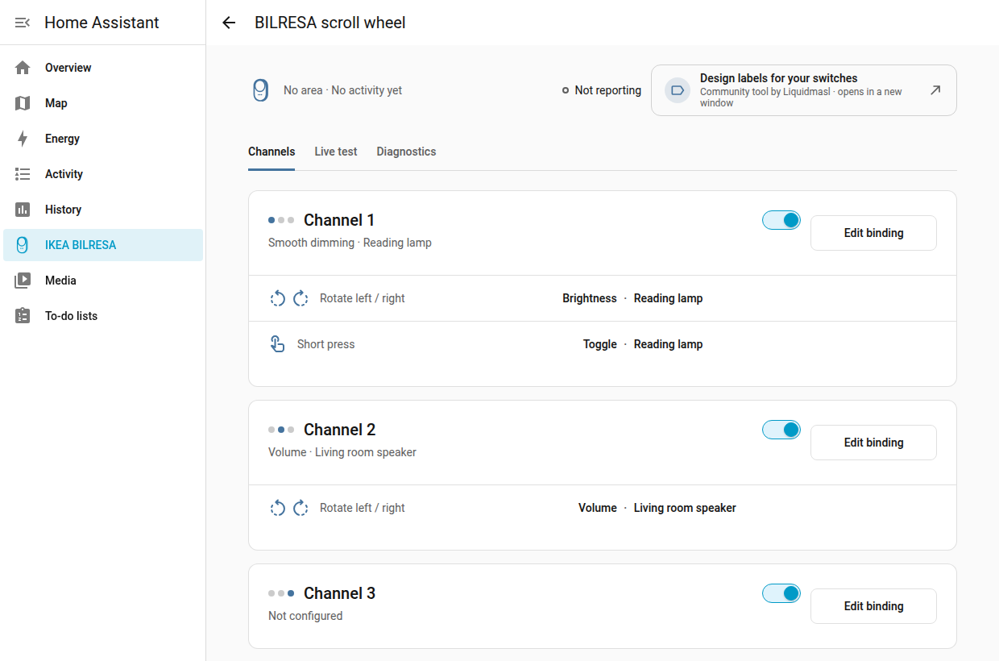
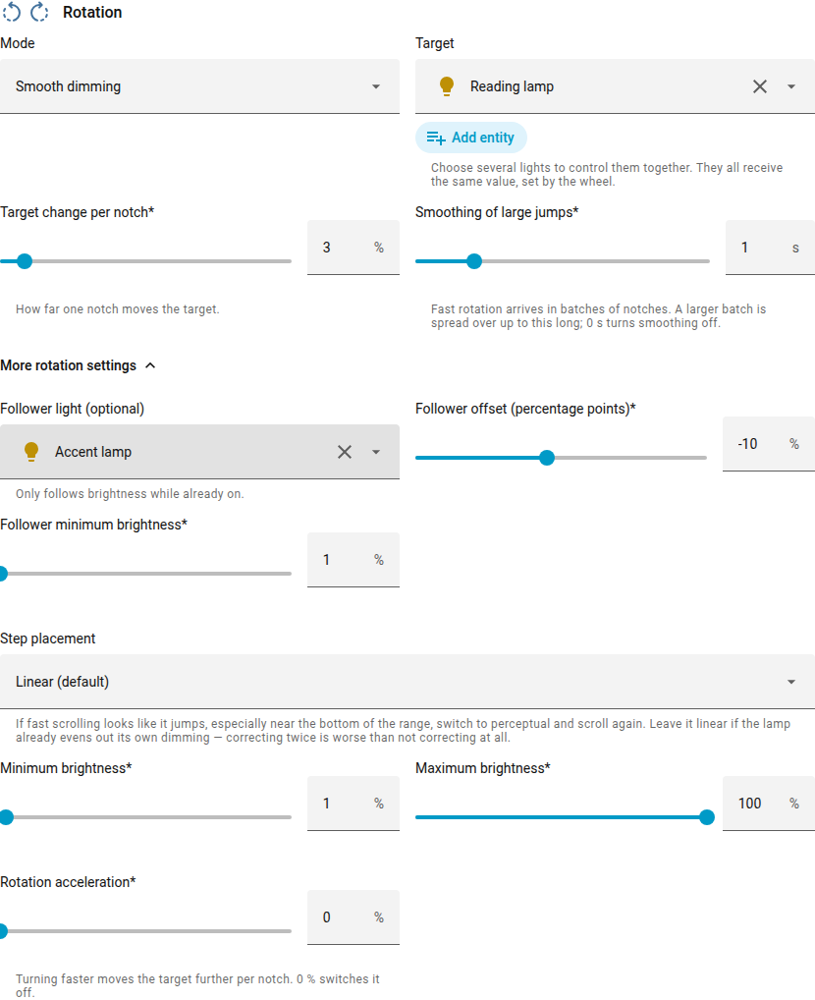
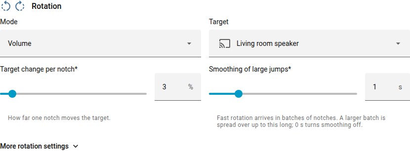
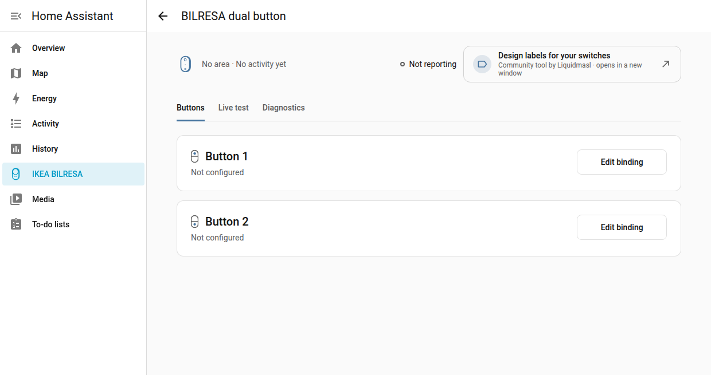
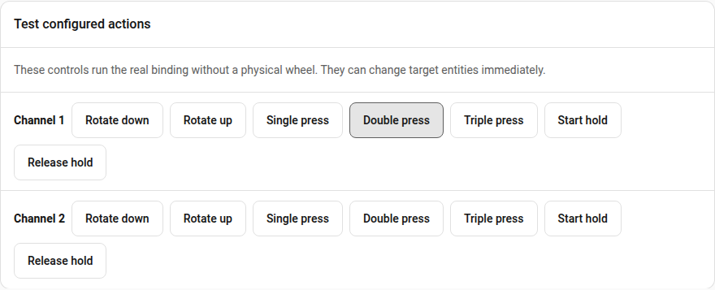

# BILRESA user manual

Use the BILRESA panel to assign a scroll wheel or dual button to lights,
speakers and other Home Assistant entities. This guide uses the English
interface of BILRESA **0.1.0**. Screenshots show a test installation with
example devices and controls.

If you are setting up your first remote, start with the
[illustrated quick start](QUICK-START.md).

- [Install and connect](#install-and-connect)
- [Find your remote](#find-your-remote)
- [Configure a scroll wheel](#configure-a-scroll-wheel)
- [Configure a dual button](#configure-a-dual-button)
- [Test your controls](#test-your-controls)
- [Troubleshoot](#troubleshoot)
- [Upgrade or roll back](#upgrade-or-roll-back)

## Install and connect

1. Use Home Assistant 2026.8 or newer and set up its Matter integration and
   Matter Server. For a BILRESA remote that uses Thread, set up a Thread
   border router and add the remote using the Home Assistant Companion app.
   Follow the [Home Assistant Matter guide](https://www.home-assistant.io/integrations/matter/#adding-a-matter-device-to-home-assistant).
2. Confirm Home Assistant lists the remote under Matter.
3. Install BILRESA from [Marketplace](INSTALLATION.md#marketplace) on Home
   Assistant 2026.11 or newer. On 2026.8–2026.10, use
   [HACS](INSTALLATION.md#hacs-on-older-home-assistant-versions). You can also
   [install it from files](INSTALLATION.md#manual-installation).
4. Restart if prompted. If the setup form did not open after installation,
   go to **Settings → Devices & services → Add integration** as an
   administrator and search for **IKEA BILRESA**.
5. In the setup form, keep the detected Matter Server address if correct.
   Otherwise, enter the WebSocket URL of the Matter Server that manages your
   remote, then select **Submit**.

If you already use an implementation with the `ikea_bilresa` integration
domain, follow the migration steps in the
[installation guide](INSTALLATION.md#configure-and-migrate).

## Find your remote

1. Open **IKEA BILRESA** in the Home Assistant sidebar.
2. Select your remote from **BILRESA devices**. The scroll wheel has a
   **Channels** tab and the dual button has **Buttons**.
3. Use **Live test** if you are unsure which physical control maps to a
   channel or button. Use **Diagnostics** to check what the panel knows about
   the remote and connection.

The example devices have no recorded gestures, so this test overview shows
**Not reporting**. In your installation, press or rotate the remote and check
**Live test** for activity.

## Configure a scroll wheel

On the wheel, the selector beneath the LEDs switches channels. Rotate the
wheel to adjust the target on the current channel. Press the wheel to run
the separate action assigned to that gesture.

1. Open **Channels** and choose **Edit binding** on the channel you want.
2. In **Rotation**, choose the control mode and target. Enter the change
   per notch. Under **More rotation settings**, keep **Rotation
   acceleration** at 0% for consistent steps as turn speed changes.
3. Set the **Short press**, **Double press**, **Triple press**, and **Hold**
   actions you want to use. The available actions depend on the target and
   response mode. Select **No action** for gestures that an existing
   automation already handles.
4. Select **Save** and test the channel in both directions.

| Rotation mode | Use it for |
| --- | --- |
| Smooth dimming | Brightness of a light or group. Start with a small change per notch. |
| Colour and colour temperature | A light that supports the selected colour mode. |
| Volume | A media player that reports its current volume and can set an absolute level. |
| Cover position | A cover that supports setting its position. |
| Temperature, fan speed and value | A climate target, fan or number entity with the corresponding control. |

### Example brightness and follower light

1. Choose **Smooth dimming** and select a primary light, such as *Reading
   lamp*. A step of 3% and acceleration of 0% are useful starting points.
2. Open **More rotation settings**.
3. Set **Follower light** to *Accent lamp*. Set an offset of **−10**
   percentage points and a minimum of **1%**, then save. At a primary
   command of 50%, the follower is set to 40% while it is on. The
   integration leaves an off follower off.
4. If either target is a group, use groups with separate members. The
   integration rejects overlaps it can see in Home Assistant. Some bridges
   expose a group without exposing its membership.

**Smoothing of large jumps** spreads a large batch of notches over the
configured duration. Try smaller steps if the lamp visibly jumps between
brightness levels. **Step placement** also lets you try perceptual dimming
if linear steps look uneven near the bottom of the range. Keep the linear
setting if the lamp already compensates for this.

### Dim a light group

Choose the group's Home Assistant light entity in **Target**. This works
with Home Assistant light groups and brightness-capable groups exposed by
Zigbee2MQTT. With all members on, turn a few notches down, pause, then
turn back up and verify every member follows. The BILRESA remote still
connects to Home Assistant through Matter.

### Example volume

1. Choose **Volume** on another channel and select the media player.
2. Set a small step, for example 3%, and leave acceleration at 0% for
   predictable changes. Start at a comfortable listening level.
3. Set **Short press** to **Play / pause** if this binding should control
   playback. Select **No action** if an automation already handles it.
4. Save, turn one notch down, then turn one up and check the volume in Home
   Assistant. If the player stops reporting its volume, rotary control
   waits for a usable reading before setting a new level.

### Example colour

On a spare channel, choose **Colour** to turn through hues on a compatible
lamp. Choose **Colour temperature** if you want the wheel to shift between
warmer and cooler whites. In **Target**, select a lamp that offers the
corresponding control in Home Assistant. Save, turn the lamp on and rotate a
few notches each way. You can keep brightness on a separate channel.

### Choose a short-press response

Use **Multi-press aware** for separate single, double or triple presses.
The integration waits briefly to see whether another press follows. Use
**Fast release** for a single-press action that should fire on release.
Use **Instant** for a single-press action on press. Fast release and Instant
require double and triple press to be unconfigured. Instant also requires
hold to be set to **No action**.

### Use scenes and automations

- Choose a scene or script for a press if the gesture should run a
  predefined action. **Cycle scenes** on short press advances through a list
  of scenes in order.
- If you use Home Assistant automations for a gesture, set the panel action
  for that gesture to **No action** to prevent duplicate commands. Verify the
  event first, then use the matching BILRESA event entity or trigger in the
  automation editor.
- The **Dial** settings control the Home Assistant dial entity. Change the
  values in **Rotation** when you want to tune what a bound lamp or player
  actually receives.

## Configure a dual button

1. Open the device and select **Buttons**.
2. Select **Edit binding** on the button you want to configure.
3. Choose actions and targets for the available press and hold gestures.
   For example, a short press can toggle a light and a double press can
   activate a scene. Gesture support depends on what the device reports.
4. Save, then check both physical buttons in **Live test**. The dual button
   supports press actions and has no rotation mode.

## Test your controls

1. Open the remote's **Live test** tab.
2. Use the physical remote and check the event shown. This confirms that
   Matter events reach the selected remote's panel.
3. Expand **Test configured actions** and use the test buttons on a configured
   channel or button to run its actions from the panel. These controls can
   change real lights, media players and other targets.
4. Verify the target itself responds as expected. A sent action is not
   proof that the device followed it.

## Troubleshoot

| What you see | What to check |
| --- | --- |
| **IKEA BILRESA** is missing from **Add integration** | Check the component directory or store download, then restart Home Assistant and reload the page. |
| The integration cannot connect | Check that Matter Server is running and that the URL belongs to the server that manages your remote. |
| A remote is missing from the panel | Verify it appears in the Home Assistant Matter integration, is powered and is a supported BILRESA model. |
| The remote sends an event and the target stays unchanged | Check that the channel is enabled, the gesture is configured, the entity is available and it supports the selected action. |
| One gesture causes two actions | Check existing automations and direct bindings for that gesture. Keep a single control path per gesture. |
| A light changes in steps | Verify transition support and reduce the change per notch if necessary. |
| Volume stays fixed | Confirm the player exposes its current volume and supports setting a level. |

See the [compatibility guide](COMPATIBILITY.md) for target requirements. When
reporting an issue, describe the remote model, integration version, Home
Assistant and Matter Server versions, gesture, expected result and observed
result. Remove personal identifiers from any screenshots or diagnostics.

## Upgrade or roll back

Back up Home Assistant before upgrading and keep a record of active bindings
and automations. After installation and restart, check one channel and its
gestures before migrating more controls. If you need to roll back, disable a
new binding before you re-enable an older automation that serves the same
gesture. Follow the [rollback guide](INSTALLATION.md#rollback).
