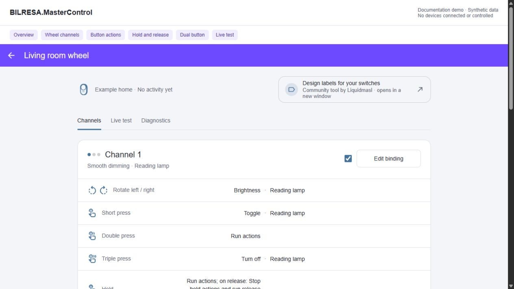
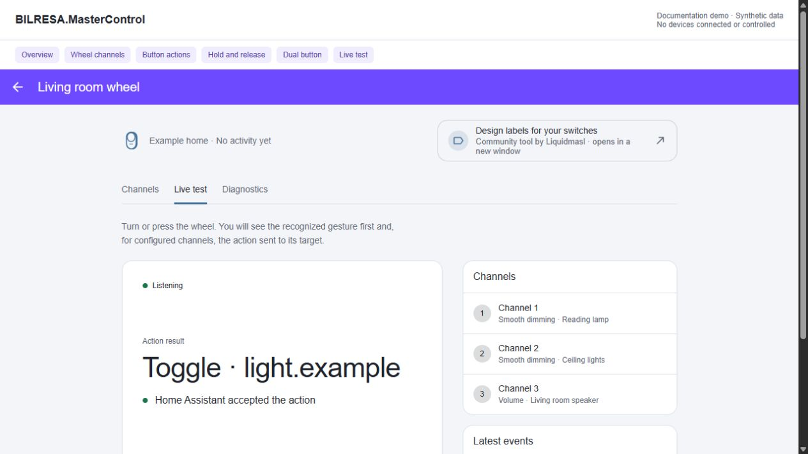

# Snelstart — BILRESA.MasterControl 0.2.1

[English](../QUICK-START.md) · [Nederlandse README](../../README.nl.md) · [Installatie](INSTALLATION.md) · [Handleiding](USER-GUIDE.md)

Begin met één afstandsbediening en één lamp. Breid pas uit als die goed werken. Alle genoemde voorbeeldapparaten zijn fictief.

## 1. Voorbereiden

U hebt Home Assistant **2026.8+**, Matter Server en de Matter-integratie nodig. Voeg uw BILRESA eerst aan Matter toe. Voor Thread is een werkend Thread-netwerk met borderrouter nodig. MasterControl doet die eerste koppeling niet zelf. Zie zo nodig de [officiële Matter-uitleg](https://www.home-assistant.io/integrations/matter/).

Controleer of u de lamp rechtstreeks in Home Assistant kunt in- en uitschakelen en dimmen. Maak bij een update eerst een back-up. Noteer welke bestaande knopautomatiseringen actief zijn.

## 2. Bestanden installeren

Volg [Installeren en bijwerken](INSTALLATION.md). Kies stabiele **0.2.1** via Marketplace of HACS. Herstart Home Assistant na installatie. Nederlands zit in hetzelfde pakket als de andere talen.

## 3. De integratie toevoegen

Ga naar **Instellingen → Apparaten & diensten → Integratie toevoegen** (*Settings → Devices & services → Add integration*). Zoek **BILRESA.MasterControl**.

Volg de verbindingsstappen. De bestaande Matter-verbinding wordt waar mogelijk hergebruikt. Wordt een adres gevraagd? Gebruik het WebSocket-adres van Matter Server dat Home Assistant kan bereiken. Dit is niet het webadres waarmee u Home Assistant opent.

Is `ikea_bilresa` al ingesteld? Behoud die integratie. Voeg geen tweede kopie toe en koppel de afstandsbediening niet opnieuw aan Matter.

## 4. Het paneel in Nederlands openen

Open uw profiel via uw naam onderaan de zijbalk. Kies **Taal → Nederlands** (*Language*). Open daarna **BILRESA.MasterControl** in de zijbalk. Zie [Taal](USER-GUIDE.md#taal) voor het verschil met de instantietaal.

Klik op uw afstandsbediening. Een draaiwiel toont drie kanalen. De drie stippen geven het kanaal aan; het zijn geen verbindingslampjes. Het tweeknopsmodel toont een bovenste en onderste knop.

De hergebruikte afbeeldingen op deze pagina tonen **Engelse labels en gesimuleerde apparaten**. De Nederlandse labels staan in de stappen hieronder. De afbeeldingen bewijzen geen fysieke werking.

## 5. Eén lamp aan het draaiwiel koppelen

Een **bedieningskoppeling** bepaalt wat een kanaal doet. Het **doel** is het apparaat dat u bedient, bijvoorbeeld uw lamp.

1. Open **Kanalen → Kanaal 1 → Bediening instellen** (*Channels → Edit binding*).
2. Kies **Modus → Vloeiend dimmen** (*Mode → Smooth dimming*).
3. Kies uw lamp bij **Doel** (*Target*).
4. Kies **Wijziging van doel per draaistap → 3%** (*Target change per notch*). Een draaistap is één voelbaar stapje van het wiel.
5. Kies bij **Kort drukken → Doel aan/uit schakelen** (*Short press → Toggle target*). Laat het doel op **Hetzelfde doel als bij draaien** staan.
6. Kies **Bedieningskoppeling opslaan** (*Save binding*).

Gebruik kanaal 1 op de fysieke afstandsbediening. Draai in beide richtingen en druk eenmaal. Kijk naar de echte lamp en haar status in Home Assistant. Omhoog dimmen kan een uitgeschakelde lamp inschakelen.

## 6. Een tweeknopsafstandsbediening gebruiken

Dit model heeft geen draaiwiel of drie kanalen. Kies **Knoppen → Knop 1 → Bediening instellen** (*Buttons → Edit binding*). Kies uw lamp als doel bij kort drukken en stel **Doel aan/uit schakelen** in. Sla op en test één druk.

Voor dimmen bij vasthouden: kies een lamp als doel, **Altijd lichter** voor de ene knop en **Altijd donkerder** voor de andere. Loslaten stopt het dimmen. Dit model ondersteunt enkel en dubbel drukken, vasthouden en loslaten; ga niet uit van driemaal drukken.

## 7. Extra knopacties toevoegen

Behoud voor het draaiwiel **Reactie → Enkel/dubbel/driemaal herkennen** (*Response → Wait for single/double/triple press*). Bij het tweeknopsmodel heet dit **Enkel of dubbel herkennen**.

- Stel dubbel drukken bijvoorbeeld in op **Acties uitvoeren** en activeer een fictieve avondscène.
- Alleen bij het draaiwiel: stel driemaal drukken bijvoorbeeld in op **Doel uitschakelen**.
- Laat ongebruikte bedieningen op **Geen actie** staan.

Voor eenvoudig dimmen bij vasthouden kiest u **Doel van draaibediening dimmen** (*Ramp rotation target*). Voor een eigen reeks kiest u **Acties uitvoeren**. Stel zo nodig **Bij loslaten → Acties bij vasthouden stoppen** in. De maximale duur is standaard 60 seconden en instelbaar van 1 tot 300 seconden.

**Acties na loslaten** zijn optioneel. Ze worden alleen uitgevoerd na een waargenomen keer vasthouden, niet bij een verlopen tijdslimiet. Zie [Vasthouden en loslaten](USER-GUIDE.md#vasthouden-en-loslaten).

## 8. Live testen

Open **Live testen** (*Live test*). Bedien de fysieke afstandsbediening. Controleer kanaal of knop, draairichting, aantal drukken, vasthouden en loslaten.

**Home Assistant heeft de actie aanvaard** betekent dat de opdracht is aanvaard. Het bewijst niet dat de lamp fysiek reageerde. Controleer de echte lamp apart.

De knoppen onder **Ingestelde acties testen** (*Test configured actions*) sturen op een echte installatie **echte opdrachten**. Een paneeltest bewijst niet dat een fysieke afstandsbediening een gebeurtenis stuurde.

## Bestaande knopautomatiseringen overzetten

Zet nieuwe knopacties eerst op **Alleen volgen (draaien blijft actief)** (*Observe only*). Kopieer de acties. Schakel daarna voor één bediening de oude automatisering uit en activeer pas dan de nieuwe knopacties. Anders kan dezelfde druk tweemaal worden uitgevoerd.

Alleen volgen laat draaien, gebeurtenisentiteiten en externe automatiseringen werken. Het is geen algemene simulatiestand. Bewaar oude automatiseringen uitgeschakeld als herstelmogelijkheid. Volg de [volledige overstap](USER-GUIDE.md#bestaande-automatiseringen-overzetten) en de [herstelstappen](INSTALLATION.md#terug-naar-de-vorige-versie).
