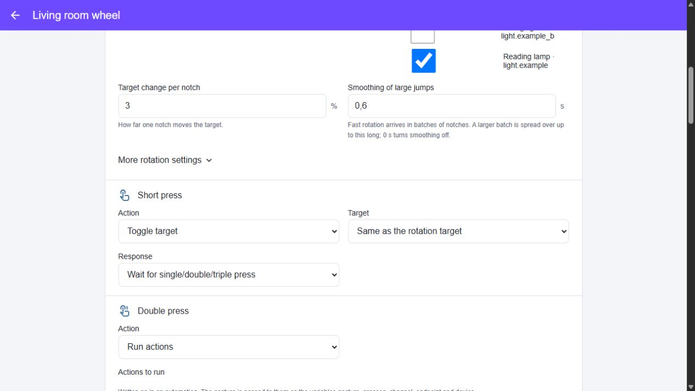
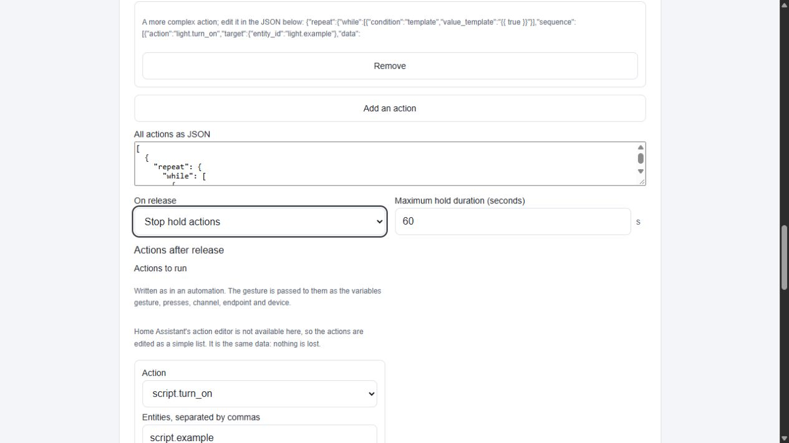
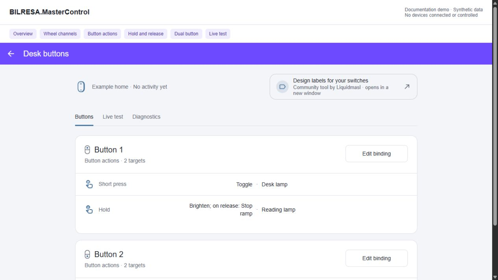
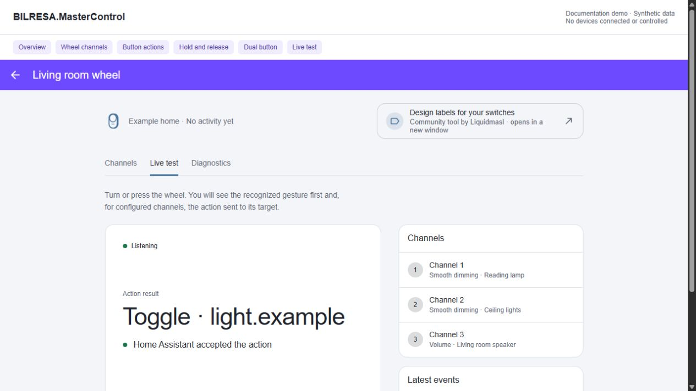

# Gebruikershandleiding — BILRESA.MasterControl 0.2.1

[English](../USER-GUIDE.md) · [Nederlandse README](../../README.nl.md) · [Snelstart](QUICK-START.md) · [Installeren en herstellen](INSTALLATION.md)

## Begin met één lamp

Volg eerst de [snelstart](QUICK-START.md). **Installeren** plaatst de bestanden. **De integratie toevoegen** maakt de verbinding met Matter. **De bediening instellen** bepaalt wat een kanaal of knop doet. Een **bedieningskoppeling** bewaart die keuze. Het **doel** is bijvoorbeeld de lamp of luidspreker die de opdrachten ontvangt.

U hebt Home Assistant **2026.8+** en werkende Matter- en Thread-infrastructuur nodig. Koppel de BILRESA eerst aan Home Assistant Matter. MasterControl ontdekt ondersteunde apparaten en luistert naar hun bedieningen. De doelen mogen via Zigbee, wifi, Matter of een andere ondersteunde integratie werken.

Alle voorbeelden in deze handleiding zijn fictief. De hergebruikte afbeeldingen tonen het werkelijke paneel met **gesimuleerde apparaten en Engelse labels**. Ze tonen geen bewijs van fysieke werking. De normale Home Assistant-keuzelijsten en actie-editor kunnen er anders uitzien.

## Taal

Het huidige paneel volgt de **profieltaal van de kijker** via `hass.language`. Open uw profiel via uw naam onderaan de zijbalk. Kies **Taal → Nederlands** (*Language → Nederlands*). De bestaande taalresolutie herkent `nl`, `nl-NL` en `nl-BE` als Nederlands. Een profieltaal die het paneel niet ondersteunt valt terug op de ingestelde instantietaal; ontbreekt ook die vertaling, dan wordt Engels gebruikt.

Dit gedrag zit al in de code van 0.2.0. Er is dus geen nieuwe automatische detectie op basis van land of apparaat toegevoegd. Het paneel levert alle talen mee en stuurt de gekozen taal mee bij het opvragen van overzichten. Oude gecachte paneelversies gebruiken de instantietaal.

Home Assistant maakt standaard **entiteitsnamen** op basis van de **instantietaal**. Die staat onder **Instellingen → Systeem → Algemeen → Taal** (*Settings → System → General → Language*). Zelf gekozen namen blijven behouden. Instellingen en keuzelijsten worden door Home Assistant vertaald. De taal daarvan volgt de normale Home Assistant-interface. Technische entiteits-ID’s, opslagvelden en gebeurtenissleutels worden niet vertaald.

Na een update: herstart Home Assistant en vernieuw de browser of app. U hoeft geen apparaten opnieuw te koppelen om Nederlands te krijgen.

## Apparaten en het paneel

Open **BILRESA.MasterControl** in de zijbalk. Namen en ruimten komen uit Home Assistant.

| Hardware | Beschikbare bediening |
| --- | --- |
| Draaiwiel | Drie kanalen; links/rechts draaien; enkel, dubbel en driemaal drukken; vasthouden en loslaten |
| Tweeknopsafstandsbediening | Twee knoppen; enkel en dubbel drukken; vasthouden en loslaten; geen draaien of kanaaldraaiwaarde |

De editor toont alleen keuzes die de gekozen hardware ondersteunt. Driemaal drukken hoort bij het draaiwiel; bied dit niet als routineactie aan op het tweeknopsmodel.


Kies een apparaat. Onder **Kanalen** of **Knoppen** (*Channels / Buttons*) ziet u de toegewezen acties. **Live testen** (*Live test*) toont ontvangen bedieningen en actieresultaten. **Diagnose** (*Diagnostics*) toont de verbindingsstatus.

Het symbool met drie stippen geeft kanaal 1, 2 of 3 aan. De gemarkeerde stip is geen verbindingsstatus. Bij twee knoppen ziet u het symbool voor de bovenste of onderste knop. Hulpteksten en toegankelijke namen geven hetzelfde nummer weer.

**Kanaal actief** schakelt het hele kanaal binnen deze integratie in of uit. Uitgeschakeld blijft de configuratie bewaard, maar worden geen integratiebusgebeurtenissen, entiteitsupdates, draaiwaarden, virtuele schakelaarupdates of directe opdrachten verstuurd. Dit is iets anders dan **Alleen volgen**, waarbij draaien en gebeurtenissen blijven werken. Het schakelt geen andere Matter-controller uit.

Kies **Bediening instellen** (*Edit binding*) om een koppeling te bewerken. **Opslaan** bewaart de wijzigingen; **Verwerpen** laat ze vallen. Als iemand anders dezelfde koppeling wijzigt, toont het paneel een conflict. Controleer dan de nieuwste waarden voordat u opnieuw opslaat.

## Draaien

Een **draaistap** is één voelbaar stapje van het wiel. De modus bepaalt welke waarde zo’n stap verandert.

| Modus | Geschikt doel | Resultaat |
| --- | --- | --- |
| Vloeiend dimmen (*Smooth dimming*) | Lamp, lampgroep of meerdere lampen | Helderheid wijzigen |
| Kleurtemperatuur (*Colour temperature*) | Lampen die dit ondersteunen | Wit licht warmer of koeler maken |
| Kleur (*Colour*) | Kleurlampen | Kleurtoon wijzigen |
| Volume | Mediaspeler, bijvoorbeeld een luidspreker | Volume wijzigen |
| Stand van afdekking (*Cover position*) | Afdekking met standbediening, bijvoorbeeld een rolluik | Stand wijzigen |
| Temperatuur (*Temperature*) | Klimaatentiteit, bijvoorbeeld een thermostaat | Doeltemperatuur wijzigen |
| Ventilatorsnelheid (*Fan speed*) | Ventilator met procentregeling | Snelheid wijzigen |
| Waarde (*Value*) | Getalentiteit of invoergetal | Getalwaarde wijzigen |
| Alleen knoppen (*Buttons only*) | Optioneel standaarddoel voor drukken | Draaien stuurt geen opdracht; knopacties blijven beschikbaar |

Het doel moet de gekozen functie ondersteunen. Zonder geldig gemeld huidig volume wordt de volumeopdracht overgeslagen. De integratie raadt geen beginvolume.

### Stapgrootte en vloeiend dimmen

**Wijziging van doel per draaistap** (*Target change per notch*) accepteert **1–25**. Begin bij een lamp met **3%**. De meeste modi rekenen dit om over het bereik van het doel. Controleer bij thermostaten en getalwaarden de echte uitkomst en de gemelde grenzen en stapgrootte.

**Grote sprongen vloeiend verdelen** (*Smoothing of large jumps*) accepteert **0–5 seconden**. Matter kan snel draaien als een groep stappen doorgeven. Eén stap wordt direct toegepast. Grotere veranderingen worden over maximaal deze tijd verdeeld. **0** schakelt dit uit. Dit laat de afstandsbediening zelf niet eerder uitzenden.

Onder **Meer draai-instellingen** (*More rotation settings*) staan helderheidsgrenzen en **Versnelling bij draaien**. Versnelling is **0–100%**; **0%** schakelt ze uit. Sneller draaien kan dan grotere veranderingen geven.

Bij sprongen in lage helderheid kunt u **Verdeling van draaistappen → Gelijkmatig voor het oog** (*Step placement → Perceptual*) proberen. Behoud **Lineair** als de lamp zelf al gelijkmatig dimt. Controleer de laagste bruikbare helderheid op de echte lamp.

## Meerdere lampen en meedimmende lampen

In de lampmodi kunt u meerdere lampen kiezen. Ze krijgen dezelfde aangevraagde waarde. Een Home Assistant-lampgroep is ook mogelijk. Verschillende lampen of groepsrapportages kunnen toch een verschillend zichtbaar resultaat geven.

Bij helderheidsbediening kunt u een **Meedimmende lamp** (*Follower light*) instellen. Dit is een tweede lamp of groep die de primaire helderheid volgt, met een eigen verschil en minimum.

Fictief voorbeeld: een primaire lamp staat op 50%. Een verschil van **−10 procentpunten** vraagt 40% voor de meedimmende lamp. Het ingestelde minimum begrenst hoe donker ze wordt.

- De meedimmende lamp verandert alleen als ze **al aan is**. Een uitgeschakelde meedimmende lamp blijft uit.
- Primaire en meedimmende doelen mogen geen lampen delen, ook niet via overlappende groepen.
- Overlap wordt bij instellen en vóór versturen gecontroleerd.
- Mislukt de primaire opdracht, dan wordt de meedimmende opdracht overgeslagen. Verouderde wachtende opdrachten worden vervangen.

## Enkel, dubbel en driemaal drukken

Elke ondersteunde drukvorm heeft een eigen actie. Kies bijvoorbeeld **Doel aan/uit schakelen**, **Doel inschakelen**, **Doel uitschakelen**, **Scène activeren**, **Script uitvoeren** of een ondersteunde media-actie. **Geen actie** laat die bediening zonder directe actie. Alleen beschikbare acties van het doel worden aangeboden.

Kort drukken kan **Hetzelfde doel als bij draaien** gebruiken. Dubbel drukken, driemaal drukken en vasthouden kunnen hun eigen doel hebben. Bij **Alleen knoppen** is het hoofddoel een standaarddoel voor drukken.

**Scènes doorlopen** activeert bij elke korte druk de volgende scène in de ingestelde volgorde. Dit vervangt de gewone korte-drukactie.



| Reactie (*Response*) | Gedrag |
| --- | --- |
| Wachten op enkel/dubbel/driemaal drukken | Herkent het voltooide aantal drukken; behoud dit bij gecombineerde bedieningen |
| Uitvoeren na de eerste keer kort loslaten | Snellere enkele druk; dubbel en driemaal drukken zijn niet beschikbaar |
| Uitvoeren zodra u drukt | Vroegste reactie; dubbel/driemaal drukken en aparte vasthoudacties zijn niet beschikbaar |

Het tweeknopsmodel biedt de wachtkeuze voor **enkel of dubbel** drukken. Sneller reageren kan niet tegelijk wachten om te weten of dezelfde druk nog een dubbele druk of vasthouden wordt. De openbare gebeurtenissen blijven in elke reactiemodus volledig onderscheiden.

## Home Assistant-acties uitvoeren

Kies **Acties uitvoeren** (*Run actions*). Hiermee start u een reeks zoals in een automatisering: acties, vertragingen, voorwaarden, keuzes of herhalingen. Een **script** is een benoemde reeks; een **scène** bewaart gewenste apparaatstanden.

Het paneel gebruikt de normale Home Assistant-actie-editor als die beschikbaar is. Anders toont het een eenvoudige lijst met **Alle acties als JSON**. Beide bewerken dezelfde gegevens. JSON is een tekstformaat voor die gegevens. Plak YAML niet in een JSON-veld.

Fictief voorbeeld voor de **YAML-editor** van Home Assistant:

```yaml
- action: light.turn_on
  target:
    entity_id: light.example
  data:
    brightness_pct: 40
```

Hetzelfde voorbeeld voor **Alle acties als JSON**:

```json
[{"action":"light.turn_on","target":{"entity_id":"light.example"},"data":{"brightness_pct":40}}]
```

Vervang de fictieve entiteit door uw eigen gekozen doel. Technische actienamen en variabelen blijven Engels. De reeks ontvangt `gesture`, `presses`, `channel`, `endpoint` en `device`. **Script starten/stoppen** kan geen variabelen meegeven; **Script uitvoeren** kan dat wel.

## Vasthouden en loslaten

Voor eenvoudig dimmen kiest u **Doel van draaibediening dimmen** (*Ramp rotation target*). Kies afwisselend lichter/donkerder of een vaste richting. Loslaten stopt deze dimopdrachten.

Voor een eigen reeks kiest u **Acties uitvoeren**. Stel in:

1. **Bij loslaten → Acties bij vasthouden stoppen** (*On release → Stop hold actions*) als de reeks alleen tijdens vasthouden mag lopen. Anders kan ze aflopen tot de tijdslimiet.
2. **Maximale duur van vasthouden** (*Maximum hold duration*): standaard **60 seconden**, bereik **1–300 seconden**. Dit stopt een reeks ook als loslaten niet wordt ontvangen.
3. Optioneel **Acties na loslaten** (*Actions after release*). Die worden alleen na een herkende keer vasthouden uitgevoerd. Een losse loslaatmelding zonder voorafgaand vasthouden of een tijdslimiet voert ze niet uit.



Plaats een vertraging in doorlopende herhalingen, bijvoorbeeld één seconde tussen kleurwissels. Stoppen voorkomt volgende stappen. Een overgang die de lamp al heeft ontvangen kan nog aflopen.

Een los gestart script of externe taak kan zelfstandig blijven lopen. Het stoppen van de bedieningsreeks stopt niet automatisch elke taak die ze ooit startte. Zet herhaling in de eigen reeks als loslaten ze moet beëindigen, of regel het stoppen van een extern script expliciet. Bewaar helpers voor kleurgeheugen als uw nieuwe acties die nog gebruiken.

## De tweeknopsafstandsbediening

Dit model heeft **Knop 1** en **Knop 2**, met eigen druk- en vasthoudbediening. Het heeft geen draaiwiel, drie draaiwielkanalen of kanaaldraaiwaarde. Gebruik enkel of dubbel drukken; veronderstel geen driemaal drukken.



Voor dimmen kiest u bij vasthouden een lamp als doel. Kies **Altijd lichter** (*Always brighten*) voor de ene knop en **Altijd donkerder** (*Always dim*) voor de andere. Loslaten stopt die knop. Kort drukken kan een ander doel bedienen. Behoud wachten op enkel of dubbel drukken wanneer u drukken met vasthouden combineert.

## Gedeelde profielen

Een gedeeld profiel houdt bestaande kanaalkoppelingen van meerdere **draaiwielen** gelijk.

1. Open **Instellingen → Apparaten & diensten → BILRESA.MasterControl → Configureren** (*Settings → Devices & services → Configure*).
2. Geef het profiel een naam en kies de draaiwielen. Dit venster ondersteunt één gekoppelde groep.
3. Het eerste gekozen draaiwiel levert de begininstellingen voor overeenkomstige kanaalkoppelingen die al bij de andere leden bestaan.
4. Als u daarna een gekoppeld kanaal opslaat, veranderen de overeenkomstige bestaande koppelingen van de andere leden mee. De editor toont de profielnaam.

Maak een ontbrekende kanaalkoppeling eerst zelf aan. Een profiel maakt geen ontbrekende koppelingen. Apparaten, entiteits-ID’s, koppelings-ID’s en vasthoudsessies blijven afzonderlijk. Loslaten op één draaiwiel stopt een andere afstandsbediening niet. Een koppeling verwijderen verwijdert alleen die ene koppeling.

Maak de ledenkeuze leeg om los te koppelen. De huidige instellingen blijven staan. Koppel alleen draaiwielen die dezelfde doelen en kanaalinstellingen moeten gebruiken. Bewaar eerst verschillende bestaande instellingen: koppelen kopieert bewust waarden.

## Entiteiten en automatiseringstriggers

Directe bedieningskoppelingen zijn optioneel. Een **entiteit** is een onderdeel waarvan Home Assistant de status bijhoudt.

- **Gebeurtenisentiteiten** tonen herkende bedieningen, met onder andere het aantal drukken (`presses`) en draaistappen (`notches`).
- **Draaiwaarde** is een aparte getalentiteit van **1 tot 100** per draaiwielkanaal. **Wijziging van draaiwaarde per draaistap** en **Versnelling van draaiwaarde** staan los van de doelbediening.
- **Virtuele schakelaars** tonen de drukstatus voor automatiseringen. Ze bewijzen niet de werkelijke aan/uit-status van de lamp.

Een **trigger** start een automatisering. De benoemde triggers zijn omhoog/omlaag draaien, eenmaal/tweemaal/driemaal drukken, vasthouden en loslaten. Kies in de trigger-editor de passende BILRESA-gebeurtenisentiteit. Het hardwaremodel bepaalt welke bedieningen werkelijk kunnen optreden.

Fictief voorbeeld:

```yaml
triggers:
  - trigger: ikea_bilresa.double_pressed
    target:
      entity_id: event.bilresa_scroll_wheel_channel_1
actions:
  - action: scene.turn_on
    target:
      entity_id: scene.example
```

Gebruik het entiteits-ID uit uw eigen installatie. De technische triggernamen en het bestaande `ikea_bilresa_event` blijven behouden. Vermijd dat een gebeurtenisautomatisering en een directe koppeling dezelfde actie allebei uitvoeren.

## Live testen en diagnose

**Live testen** toont welke bediening is ontvangen en welk kanaal of welke knop actief was. Bij ingestelde koppelingen volgt het actieresultaat: aanvaard, overgeslagen, in uitvoering of mislukt.



**Home Assistant heeft de actie aanvaard** bevestigt de verzending en aanvaarding van de opdracht. Controleer de gemelde apparaatstatus en de fysieke reactie apart.

De paneelknoppen onder **Ingestelde acties testen** voeren de echte koppeling uit. Ze kunnen op een echte installatie een lamp schakelen, een afdekking bewegen of een temperatuur veranderen. Kies een geschikt doel. Paneelactiviteit wordt als paneeltest gemarkeerd en bewijst geen ontvangst van een fysieke afstandsbediening.

**Diagnose** toont verbinding en gebeurtenisbron. Controleer exportbestanden vóór u ze deelt. Schermafbeeldingen uit uw eigen huis kunnen namen, entiteiten en netwerkgegevens bevatten.

## Bestaande automatiseringen overzetten

1. Maak een back-up van de componentmap, integratie-instellingen, bedieningskoppelingen en automatiseringen, inclusief hun aan/uit-status.
2. Kopieer de knopacties naar de juiste koppeling. Kies eerst **Knopacties → Alleen volgen (draaien blijft actief)** (*Button actions → Observe only*).
3. Controleer ontvangen bedieningen. Laat de actiegegevens controleren zonder ze uit te voeren waar de editor dit aanbiedt. De testknoppen voeren ze wel echt uit.
4. Schakel de oude automatisering voor **één bediening op één kanaal of knop** uit. Zet daarna de vervangende knopacties op **Actief**.
5. Test de fysieke druk, vasthouden en loslaten. Controleer op dubbele opdrachten voordat u het volgende kanaal overzet.
6. Bewaar oude automatiseringen uitgeschakeld voor herstel. Verwijder geen helpers of ondersteunende automatiseringen die de nieuwe reeks nog gebruikt.

Alleen volgen onderdrukt uitsluitend de directe **knopacties van de koppeling**. Draaien blijft actief. Gebeurtenisentiteiten, triggers en virtuele schakelaars kunnen oude automatiseringen nog starten. Het is geen algemene proefstand. **Geen actie** maakt slechts één directe bediening leeg. **Kanaal actief uit** onderdrukt de hele kanaaluitvoer van deze integratie, inclusief gebeurtenissen waarop oude automatiseringen kunnen steunen.

Behoud bij dezelfde integratie de bestaande Matter-pairing, integratie-instelling en entiteits-ID’s. Zie [Terug naar de vorige versie](INSTALLATION.md#terug-naar-de-vorige-versie).

## Probleemoplossing

| Probleem | Concrete controle |
| --- | --- |
| Integratie ontbreekt na kopiëren | Staat de complete map direct onder `custom_components`? Controleer HA-versie, herstart en opstartlog. |
| Instellen vraagt een serveradres | Gebruik het bereikbare Matter Server-WebSocket-adres, niet de HA-webpagina. Controleer Matter en de serverapp. |
| Geen afstandsbediening of fysieke gebeurtenissen | Controleer Matter-beschikbaarheid, Thread-netwerk, batterij en Diagnose. Opnieuw pairen is niet de eerste herstelstap. |
| Draaien werkt, drukken niet | Controleer actief kanaal, Knopacties → Actief, toewijzingen, reactie en foutmelding. |
| Dubbel/driemaal drukken of vasthouden ontbreekt | Kies de wachtreactie. Controleer het hardwaremodel. Snellere reacties sluiten bepaalde acties uit. |
| Eén druk voert iets tweemaal uit | Controleer oude automatiseringen, gebeurtenis- en schakelaarverbruikers en directe koppelingen. |
| Kleurwissels lopen door na loslaten | Controleer stoppen bij loslaten, apart gestarte scripts en reeds verstuurde lampovergangen. |
| Actie na loslaten werkt niet | Er moet eerst vasthouden zijn herkend. Een losse loslaatmelding of verlopen tijdslimiet voert ze niet uit. |
| Meedimmende lamp blijft uit | Dat is de bedoeling als ze uit staat. Controleer ook overlap en fouten van het primaire doel. |
| Volume verandert niet | Wacht op een geldige actuele volumemelding van de mediaspeler. |
| Gedeeld kanaal verandert niet mee | Controleer profielleden, een bestaande overeenkomstige kanaalkoppeling en geslaagd opslaan. |
| Paneel toont Engels | Controleer profieltaal, geïnstalleerde versie 0.2.1, herstart en browserverversing. Zie Taal. |
| Entiteitsnaam blijft Engels | Controleer instantietaal en of de naam handmatig is aangepast. Het paneel en standaardnamen gebruiken verschillende taalbronnen. |
| Paneel ziet er oud uit | Controleer de werkelijk geïnstalleerde manifestversie, herstart en herlaad de frontend. |
| Actie-editor ontbreekt | Gebruik de lijst of JSON-terugval; de opgeslagen reeks blijft behouden. |
| Opslaan meldt conflict | Lees de nieuwste waarden en pas uw wijziging opnieuw toe; overschrijf niet blind. |

Test steeds één afstandsbediening en doel. Voor softwareherstel volgt u de [installatie- en herstelhandleiding](INSTALLATION.md#terug-naar-de-vorige-versie). Automatische tests en previews bewijzen geen fysieke timing of werking van elke combinatie. Zie het [hardwarevalidatieplan, Engels](../HARDWARE-VALIDATION.md).
